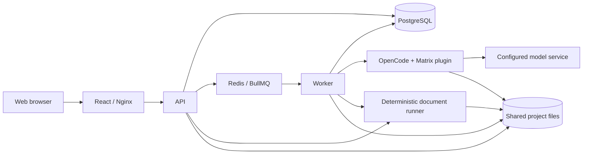

# Requirements Manager for Matrix Test Requirement Generation

[中文插件文档](README-zh.md) · [Management application source](requirements-manager/)

Requirements Manager is a web application for generating, reviewing, editing, and exporting test requirements from software requirement documents. It combines the Matrix Phase 2 generation workflow with source-document browsing, bidirectional traceability, human quality assessment, and revision history.

This repository is **self-contained**: it includes the **Matrix generation plugin, deterministic document runner, and complete Requirements Manager application** under `requirements-manager/`. Clone this repository once and follow the steps below to deploy the complete system.

## What the system does

- Import a ZIP archive containing DOCX source requirement documents.
- Generate test requirements through OpenCode and a configured language model, with live progress and execution logs.
- Read source documents alongside generated requirements and navigate their traceability links.
- Review requirement quality and record scores and comments.
- Edit requirements online, rebuild the published document, and compare revisions.
- Download the generated test requirement document and export a completed review report.

The management application covers **Phase 2: test requirements**. The broader Matrix plugin also provides other embedded-software testing phases; deploying this application does not automatically execute those phases. The current web interface uses Chinese labels; this guide includes the relevant labels for navigation.

## System architecture



Docker Compose deploys Web, API, Worker, OpenCode, PostgreSQL, Redis, and MinIO. The deterministic runner runs in the OpenCode container. Project documents, generated artifacts, and revision snapshots currently use the shared project filesystem; MinIO is included in the deployment but is not the main document storage path.

## Prerequisites

- Git.
- Docker Engine 24+ or Docker Desktop configured for Linux containers, with Docker Compose v2.
- At least 8 GB of available memory; 16 GB is recommended.
- Network access to container registries and package registries during the first build.
- Access to a supported model service and its credentials. Model generation requires this service even when the application runs locally.

Host installations of Node.js, Bun, PostgreSQL, and Redis are not required for the Docker deployment. The images install the application runtimes and build the Matrix plugin.

## Installation and deployment

### 1. Clone the repository

```bash
git clone https://github.com/tr-enginner/test-req.git
cd test-req/requirements-manager
```

The required layout is:

```text
test-req/
├── src/                       # Matrix plugin and deterministic runner
├── skills/
├── templates/
├── package.json
└── requirements-manager/      # Included management application
    ├── apps/api/
    ├── apps/web/
    ├── apps/worker/
    ├── docker/
    ├── docker-compose.yml
    └── .env.example
```

If you already have this repository, enter its included `requirements-manager/` directory. Keep this directory layout: the OpenCode image builds the plugin and runner from the repository root, while the application images build from `requirements-manager/`.

**Run all Docker Compose commands below from `test-req/requirements-manager/`.**

### 2. Create the environment configuration

On Linux or macOS:

```bash
cp .env.example .env
```

On Windows PowerShell:

```powershell
Copy-Item .env.example .env
```

Edit `.env`, replacing the example secrets before starting the services:

```dotenv
JWT_SECRET=replace-with-a-random-secret-of-at-least-32-characters
ADMIN_USERNAME=admin
ADMIN_PASSWORD=replace-with-a-strong-admin-password
OPENCODE_USERNAME=opencode
OPENCODE_PASSWORD=replace-with-a-strong-opencode-password
MINIO_SECRET_KEY=replace-with-a-strong-minio-password
WEB_ORIGIN=http://localhost:8080
COOKIE_SECURE=false
DEEPSEEK_API_KEY=replace-with-your-provider-api-key
```

Keep the other values from `.env.example` for the default Compose deployment, including the internal hostnames `postgres`, `redis`, `minio`, and `opencode`. `WEB_ORIGIN` must match the address used in your browser. For access from another computer, use the server's address, for example `http://192.168.1.100:8080`. Keep `COOKIE_SECURE=false` for HTTP; use `true` when serving the application over HTTPS.

The bundled initial OpenCode configuration selects `deepseek/deepseek-v4-flash`. The example above uses `DEEPSEEK_API_KEY` for that provider. To use a different provider or model, add its required environment variables and configure the model in step 4 before generating requirements. A valid API key alone does not guarantee access to the selected model.

Do not commit `.env` or model credentials.

### 3. Build and start the services

```bash
docker compose config --quiet
docker compose up --build -d
docker compose ps
docker compose logs --tail=100 api worker opencode
```

The initial build downloads dependencies and may take several minutes. On startup, the API automatically applies database migrations and initializes the administrator account. Confirm that the services remain running and the logs contain no startup errors.

Open **[http://localhost:8080](http://localhost:8080)** and sign in with `ADMIN_USERNAME` and `ADMIN_PASSWORD` from `.env`.

The default Compose file also publishes API port `3000`, PostgreSQL port `5432`, and MinIO console port `9001`. OpenCode (`4096`) and the document runner (`4097`) are accessed inside the container network. The browser uses the Web service's `/api/` proxy.

### 4. Configure and verify the model

As an administrator, open **Settings (设置)** from the project list and select the OpenCode configuration editor. Confirm that the model and provider settings match your available service.

The initial configuration is:

```json
{
  "$schema": "https://opencode.ai/config.json",
  "model": "deepseek/deepseek-v4-flash",
  "plugin": ["file:///plugin/dist/index.js"]
}
```

Preserve the Matrix plugin entry. Save the configuration and wait for the automatic OpenCode restart to complete. Configuration changes are blocked while Phase 2 jobs are queued or running; finish or terminate those jobs first.

Provider credentials supplied through `.env` are loaded when containers are created. After changing these values, run:

```bash
docker compose up -d --force-recreate opencode api worker
```

The next section's small end-to-end run verifies model access as well as the rest of the deployment. A running container alone does not verify model generation.

## Run your first project

### 1. Prepare and upload source documents

Create a ZIP containing one or more `.docx` software requirement documents. Subdirectories are allowed. Every regular file must be DOCX; remove PDFs, images, `.doc` files, hidden system files, and any `.matrix` directory before uploading.

For example:

```text
example-requirements.zip
└── requirements/
    ├── software-requirements.docx
    └── interface-requirements.docx
```

After signing in, click **New project (新建项目)**, enter a project name, and upload the ZIP. The application extracts and indexes the source documents. New projects enter `PENDING_GENERATION`; imported archives do not supply pre-existing generation results.

### 2. Generate test requirements

Open the project and click **Start generating test requirements (开始生成测试需求)**. Monitor queue status, chapter progress, and execution logs on the project page. Use **Terminate generation (终止生成)** if you need to cancel the run.

Generation duration depends on document size, model response time, and provider limits. Successful completion requires valid final artifacts, including `.matrix/reports/phase2-test-requirements.docx`, rather than just the end of a model session. The project then enters `READY_FOR_REVIEW`.

### 3. Inspect traceability and review quality

Open the review workspace. The left pane previews the original DOCX; the right pane displays generated test requirements. Use the document outlines to navigate chapters. Source references link requirements to their originating document sections, and source sections link back to related requirements.

Assess each evaluable chapter or functional leaf, recording scores and revision suggestions. The overall content-quality score uses:

```text
Overall score = Accuracy × 40% + Coverage × 35% + Testability × 25%
```

Human quality assessment is separate from the Matrix generation workflow's internal review gates.

### 4. Edit and publish a revision

Click **Edit document (编辑文档)**, update the available requirement fields or table content, then select **Save and rebuild (保存并重建)** and enter a version name. Wait for background publication to complete before downloading the updated document.

Editing uses the deterministic runner to rebuild artifacts and update traceability and revision records. It does not require a new model-generation session. Use the revision history and change-analysis view to inspect published versions and compare changes. If publication fails after a draft is saved, use the displayed retry or discard controls; a saved draft is not yet a published document.

### 5. Export results

- **Download third-party test requirements (下载第三方测试需求)** downloads the generated Phase 2 DOCX.
- **Export review report (导出评审报告)** exports the human review results after all required review nodes have been assessed. The interface lists any missing assessments.

A successful first run should let you upload a DOCX archive, complete generation, navigate a source reference, save an assessment, publish an edit, and download the resulting document.

## Operations and troubleshooting

Run these commands from `requirements-manager/`:

```bash
# Inspect services and recent errors
docker compose ps
docker compose logs --tail=100 web api worker opencode

# Follow generation logs (Ctrl+C stops log viewing)
docker compose logs -f worker opencode

# Stop the deployment while retaining persistent volumes
docker compose down

# Start it again
docker compose up -d

# Rebuild after updating application, plugin, or runner source code
docker compose up --build -d
```

| Symptom | What to check |
| --- | --- |
| Web page does not open | Check `web` and `api` logs, port `8080` availability, and host firewall rules. |
| Login fails | Check API startup/migration logs and the initial admin credentials. If the password was changed in Settings, use the updated password. Check `WEB_ORIGIN` and the HTTP/HTTPS cookie setting. |
| Generation fails or stops progressing | Inspect `worker` and `opencode` logs; verify provider credentials, selected-model access, network connectivity, and matching OpenCode authentication values. |
| OpenCode configuration cannot be saved | Finish or terminate queued/running generation jobs, validate that the configuration is a JSON object, and inspect `opencode` and `api` logs. |
| Image build cannot find parent files | Keep the complete repository layout shown above, including the root plugin source, and run Compose from `requirements-manager/`. |
| A host port is already in use | Stop the conflicting service or adjust the relevant Compose port mapping; update `WEB_ORIGIN` if the Web address changes. |

Persistent volumes store PostgreSQL data, Redis queue data, MinIO data, project files, and OpenCode configuration. Back up these volumes together before upgrades. **`docker compose down -v` deletes the persistent volumes**, including documents, review records, and model configuration.

The default Compose file is intended for local deployment and exposes debugging ports with a default database password. For a shared server, replace database credentials consistently in Compose and `DATABASE_URL`, restrict infrastructure ports, and publish Web through an HTTPS reverse proxy that supports SSE streaming.

## Development and reproducibility

For a reproducible experiment, record this repository's commit ID, the model/provider identifier, generation settings, and the input-document version. The commit identifies both the Matrix plugin and the included management application:

```bash
# From the root of test-req/
git rev-parse HEAD
```

Model-generated content may vary between runs. Store the generated DOCX and relevant review/revision records alongside your experiment metadata where disclosure is permitted.

For application development, install Node.js 22+ and npm 10+, then run from `requirements-manager/`:

```bash
npm ci
npm run db:generate
npm run build
npm test
```

For Matrix plugin development, run from the parent repository with Bun:

```bash
bun install
bun run build
bun run typecheck
bun test
```

Rebuild the OpenCode image after changing the parent plugin or runner; restarting an existing container does not install source changes.

## Further documentation

- [Original Chinese Matrix plugin README](README-zh.md)
- [Requirements Manager installation and application guide](requirements-manager/README.md)
- [Requirements Manager architecture](requirements-manager/docs/整体架构.md)
- [Online editing and publication](requirements-manager/docs/phase2-online-editor.md)
- [ARM64 offline deployment](requirements-manager/offline/README-OFFLINE.md) — requires a separately prepared image bundle and a reachable model service.
- [Matrix Phase 2 architecture](docs/phase2-arch.md)
- [Source-document parsing](docs/phase2-parsing.md)
