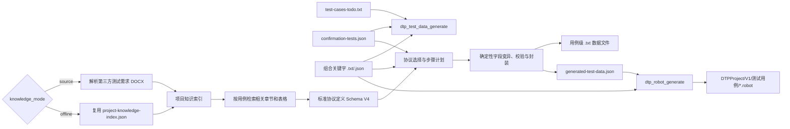

# DTP 用例级数据生成设计文档

> 适用版本：当前 `matrix-embedded-agent` 主流程（协议定义 Schema V4）
>
> 核心入口：`dtp_test_data_generate`
>
> 下游入口：`dtp_robot_generate`

## 1. 文档目的

本文档描述当前代码中实际生效的 DTP 数据生成架构、输入输出、知识构建、协议编译、用例步骤实例化、模型职责、缓存、质量检查和 Robot 衔接方式。

当前正式流程是“按用例、按步骤生成所需数据”，不是先全量物化项目下所有可能的协议 `.txt` 文件。项目级知识和标准协议仍然存在，但它们以可复用 JSON 知识资产的形式服务于用例级生成。

本文档不描述 A 同学负责的测试用例设计和模板生成细节，也不描述 B 同学负责的 DTP 执行器内部实现。

## 2. 当前设计结论

数据生成采用“代码提取 + 模型理解 + 代码生成”的三层架构：

1. 代码确定性提取 DOCX 文档结构、章节、正文、表格、引用和关键字定义。
2. 模型理解复杂的协议关系和自然语言语义，输出结构化协议或步骤计划。
3. 代码依据标准协议确定性完成字段修改、分帧、校验、封装、文件命名、落盘和质量验证。

核心原则：

- 文档表格决定字节物理布局，模型不能覆盖表格已明确的位置。
- 模型输出结构化计划，不直接写最终 `.txt` 文件。
- `step_desc` 是用例数据生成的唯一权威步骤语义。
- `expected_result` 只为下游断言保留，不参与协议选择或数据生成。
- `test_purpose` 只作为用例元数据保留，不参与步骤协议选择。
- A 侧参数中只直接信任 `${time}`；其他业务实参由本阶段重新推导。
- 缺少字段值可以按规则使用 `00` 并告警，但缺少可信协议布局不能伪造为正常数据。
- 项目级协议知识可复用，用例级文件按步骤独立生成。

## 3. 能力边界

### 3.1 本阶段负责

- 读取 `.matrix/data/test-cases-todo.txt`。
- 读取 `.matrix/data/confirmation-tests.json`。
- 精确查找 `.matrix/data/DTPProject/组合关键字` 下的关键字定义。
- 在 `source` 模式下解析项目内第三方测试需求 DOCX 及其明确引用的需求规格说明 DOCX。
- 在 `offline` 模式下复用已解析的项目知识。
- 构建或复用标准协议定义。
- 根据步骤语义选择协议、变体、命令和字段修改计划。
- 动态生成步骤所需的数据文件。
- 推导关键字实际参数。
- 生成 Robot 渲染所需的结构化 JSON。
- 输出诊断、性能、缓存和可追溯资产。

### 3.2 本阶段不负责

- 不重新设计测试用例。
- 不模糊匹配或替换 A 侧给出的 `key_name`。
- 不读取 `requirements-context.json` 作为知识或步骤语义来源。
- 不依赖 `source-confirmation-tests.json`。
- 不预生成项目下所有可能的协议数据文件。
- 不直接生成 `.robot` 文件。
- 不执行 Robot 或 DTP 测试。

### 3.3 已下线的正式入口

插件不再注册 `dtp_project_data_files_generate`。源码中的 `runDtpProjectDataFilesGeneration()` 仅作为带 `@deprecated` 标记的内部迁移代码保留，不属于当前正式工具链，也不应由 skill 或流水线调用。

## 4. 总体流程



Phase 6 闭环会先确保标准协议定义，再执行用例级数据生成，最后调用 Robot 渲染。单独调用 `dtp_test_data_generate` 时，协议准备也会在工具内部按需执行。

## 5. 工具入口

### 5.1 用例级数据生成

工具名称：

```text
dtp_test_data_generate
```

主要参数：

```text
project_dir       可选，必须等于当前 OpenCode workspace
knowledge_mode    可选，source 或 offline，默认 source
*_docs            可选的文档上下文参数
```

核心实现：

```text
src/tools/dtp-case-test-data-generator.ts
src/tools/dtp-data-generation-core.ts
runDtpCaseDataInstantiation()
ensureDtpProtocolDefinitions()
```

### 5.2 Robot 脚本生成

工具名称：

```text
dtp_robot_generate
```

该工具只消费已经生成的结构化用例数据，负责关键字校验、`Resource`、`.vte`、路径格式化和 `.robot` 落盘，不参与协议理解和业务参数推导。

## 6. 工作空间与路径

所有路径都以当前 OpenCode workspace 为根，不绑定固定盘符，也不搜索父目录、兄弟项目或无关工作区。

```text
.matrix/
├─ data/
│  ├─ test-cases-todo.txt
│  ├─ confirmation-tests.json
│  ├─ dtp-generation/
│  │  ├─ project-knowledge-index.json
│  │  ├─ dtp-table-evidence-index.json
│  │  ├─ document-reference-graph.json
│  │  ├─ protocol-evidence-trace.json
│  │  ├─ knowledge-package-manifest.json
│  │  ├─ dtp-protocol-definitions.json
│  │  ├─ command-dictionary-index.json
│  │  ├─ generated-data-files-index.json
│  │  ├─ generated-test-data.json
│  │  ├─ generated-test-data-diagnostics.json
│  │  ├─ dtp-argument-retry-context.json
│  │  ├─ dtp-case-data-generation-performance-report.json
│  │  ├─ dtp-data-model-cache.json
│  │  ├─ model-cache-entries/
│  │  ├─ document-cache/
│  │  ├─ cases/
│  │  ├─ diagnostics/
│  │  └─ generated-data-files-index-cases/
│  └─ DTPProject/
│     ├─ 组合关键字/
│     └─ V1/
│        ├─ 输入数据/
│        │  ├─ 输入流/用例生成/{case_id}/*.txt
│        │  └─ 输出流/用例生成/{case_id}/*.txt
│        └─ 测试用例/*.robot
└─ reports/
   └─ *第三方测试需求*.docx
```

当前 runtime 固定为 `V1`。`DTPProject/V1/测试用例` 是 Robot 输出目录，不是数据生成输入目录。

## 7. 用例输入契约

### 7.1 待执行列表

`.matrix/data/test-cases-todo.txt` 每行一个 `case_id`。它是本次重跑集合：

- 文件中存在的用例会重新生成。
- 不在本次 todo 中、但此前已生成且仍在最新 `confirmation-tests.json` 中有效的用例会保留。
- 中断后重新执行时，可通过缩小 todo 控制重跑范围。

### 7.2 确认测试用例

`.matrix/data/confirmation-tests.json` 中按 `case_id` 精确匹配用例。

只有满足以下条件的用例可执行：

```text
translate_status == "success"
test_environment != "硬平台测试环境"
```

步骤字段：

```text
key_name          精确关键字名称
step_desc         数据生成的权威语义
parameter         只直接消费其中的时间值
expected_result   仅保留给下游，不参与数据生成
```

字段别名仍兼容旧格式，但标准写法是 `key_name`、`step_desc`、`parameter` 和 `expected_result`。

### 7.3 编码兼容

JSON/TXT 读取兼容 UTF-8、UTF-8 BOM、GBK/GB2312 等常见编码。字段读取允许已定义的历史别名，但业务语义不依赖中文显示名的模糊匹配。

## 8. 关键字与参数推导

关键字定义位于：

```text
.matrix/data/DTPProject/组合关键字/*.txt
.matrix/data/DTPProject/组合关键字/*.json
```

处理规则：

1. `key_name` 必须精确命中关键字名称。
2. `.txt` 用于确认 Robot 关键字及参数顺序。
3. `.json` 的参数注释用于识别时间、数据文件、通道、循环周期等参数语义。
4. `${para1}`、`${para2}`、`${para3}` 本身没有业务语义，不能仅凭变量名猜测。
5. 上游只直接提供 `${time}`；其他参数由步骤、关键字注释、标准协议和已生成文件共同推导。
6. 数据文件参数最终指向当前用例目录下实际存在的文件。

关键字不存在时记录告警，不自动换成语义相近的关键字。

## 9. 知识模式

### 9.1 `source` 模式

默认模式。工具在当前 workspace 内发现、解析并缓存源文档。

主文档规则：

- 只解析 `.docx`。
- 文件名必须包含“第三方测试需求”。
- 最多向下搜索 6 层目录。
- `.matrix/reports` 可以被发现。
- `.matrix/data`、依赖目录、构建产物和工作区外目录不会被扫描。
- 内容完全相同的重复 DOCX 会按内容哈希去重。

外部引用规则：

- 只跟随第三方测试需求文档明确引用的“需求规格说明”DOCX。
- 引用文档可以位于 workspace 的其他目录。
- 需求规格说明中的二次外部引用只记录，不继续递归解析。
- 找不到外部需求规格说明时，可以回退到第三方测试需求文档自身同名附录、章节或表格，但必须精确匹配并告警。

### 9.2 `offline` 模式

离线模式不扫描源 DOCX，最低要求是：

```text
.matrix/data/dtp-generation/project-knowledge-index.json
```

该文件必须是可读 JSON，并至少包含可复用的 snippets、tables 或 section protocol models。推荐同时携带：

```text
dtp-protocol-definitions.json
command-dictionary-index.json
dtp-data-model-cache.json
model-cache-entries/
document-reference-graph.json
protocol-evidence-trace.json
```

离线模式把复制进来的知识视为受信快照：

- 不校验 manifest SHA-256。
- 不校验源文档时间戳和内容哈希。
- 不要求原始 Word 文档存在。
- 版本差异只告警，不因 metadata 不一致阻断。
- 可读取旧协议定义并在内存中迁移；只有定义缺失或不可用时才从知识索引重建。
- 不会静默切回 `source`。

`knowledge-package-manifest.json` 在离线模式下只作诊断信息，不是强制门禁。

## 10. 第一层：结构化文档提取

代码负责把 DOCX 转换为可追踪的项目知识索引：

```text
.matrix/data/dtp-generation/project-knowledge-index.json
```

主要内容：

- `source_documents`：来源文件、角色、内容哈希和解析状态。
- `snippets`：章节正文和输入流/输出流文本。
- `tables`：标题、表头、标准化行、单元格坐标和结构化 HTML。
- `section_protocol_models`：按章节组织的协议上下文。
- `packet_model_candidates`：代码侧识别的候选帧模型。
- `references`：章节、附录、表格和外部需求规格说明引用。
- `warnings`：缺失、歧义和解析降级信息。

DOCX 抽取结果按源文件内容哈希和 extractor 版本缓存到 `document-cache/`。源文档未变化时不会重复解析；单个文档变化只失效该文档和受影响协议。

## 11. 文档引用与证据图

引用解析保留完整定位符，例如：

```text
表3.1.1.5-1
第3.1.2节
附录K
见需求规格说明附录G表9
```

处理策略：

- 表格、章节和附录优先按完整编号精确解析。
- 引用可以从正文或表格单元格产生。
- 引用闭包最多扩展三轮，并使用 visited 集合避免循环。
- 被引用证据会标注 `frame_layout`、`field_dictionary`、`payload_definition`、`selector`、`checksum_definition` 或 `related_transport` 等角色。
- 引用角色只用于组织证据，不能把不兼容总线或接口的字节布局复制到其他协议。

输出：

```text
document-reference-graph.json
protocol-evidence-trace.json
```

前者记录文档引用图，后者记录每个标准协议最终来自哪些文档、章节和表格。

## 12. 表格证据与上下文预算

知识索引可以同时保存 `table_html`、`rows` 和 `cells`，因为它们分别服务于结构保真、确定性处理和坐标定位；但发送给模型时不会重复携带三份完整内容。

模型证据选择规则：

- 帧格式表和小表尽量完整保留。
- 大型支持表、字典表只保留表头、查询命中行、必要相邻行和合并单元格锚点。
- 有 `table_html` 时，模型 payload 不再重复发送完整 `rows` 和 `cells`。
- 每个协议理解窗口最多两个主表。
- 每个 section 最多两个协议理解窗口。
- 支持表最多五个。
- 模型可返回一次 `need_more_evidence`，按现有 `table_id + row_keys + fields` 定向补取。

预算：

```text
协议关系分析       约 20,000 token
协议理解           约 30,000 token
```

这不是简单截断原文，而是按“Case -> 总线/接口 -> Section -> 引用 -> Table/Row”逐级缩小证据范围，保留最相关且结构完整的内容。

## 13. 第二层：模型理解

模型只在非确定性理解任务中参与。

### 13.1 协议关系分析

`model_relation_analysis` 判断：

- 哪些表是帧格式表。
- 哪些表是字段说明、字典或校验说明。
- 哪些表需要与正文或引用表组合理解。
- 输入流、输出流和总线/接口归属。
- 字典展开、枚举展开和字段值来源。

关系分析不生成最终数据文件。

### 13.2 协议理解

`model_protocol_understanding` 把限定 section 的正文、主表和引用证据转换为标准协议定义。模型可以补充协议名称、字段语义、枚举、位域、引用关系和分块关系，但表格中已明确的列位置和字节顺序由代码保持权威。

### 13.3 用例步骤规划

当确定性选择仍不充分时，`case_step_planning` 接收：

- `step_desc`。
- 有界的候选 `protocol_id`。
- 候选协议摘要、字段布局和校验定义。
- 直接相关的表格、选择器和命令字典证据。
- 当前总线专用 fallback Profile。

它输出结构化计划，例如协议选择、变异类型、字段修改、帧序列操作和参数值。它不输出最终字节文件。

### 13.4 局部质量重试

只有当前步骤质量需要修复时才调用 `case_step_retry`。重试输入只包含当前步骤计划、质量问题和有界证据，不重新处理无关用例或整份文档。

## 14. 标准协议定义

标准协议写入：

```text
.matrix/data/dtp-generation/dtp-protocol-definitions.json
```

当前 Schema V4 的主要结构：

```text
sections
protocols
protocol_groups
protocol_families
interface_envelopes
selector_relations
relations
non_generated_tables
warnings
```

单个协议重点字段：

- `protocol_id`：稳定标识。
- `base_file_name`：中文业务名称。
- `flow_direction`：input、output 或 unknown。
- `frames[].byte_layout`：完整帧字节基线。
- `frames[].field_layout`：字段角色、偏移、长度和位域。
- `frames[].checksum`：校验算法与范围。
- `bus_context`：总线、接口层级、控制器和模式。
- `frame_envelope`：逐帧固定接口前缀。
- `block_layout`：SpaceWire 等大块协议结构。
- `semantic_identity`：协议角色、实体和消息长度。
- `transport`：帧数和线缆侧长度。
- `provenance`：来源文档、章节和表格。

`frame` 是旧 Schema 的只读兼容字段；当前标准表示是 `frames[]`。

## 15. 协议族、变体与组合

`protocol_families` 用于表达“同一业务族的多个结构变体”和“必须组合发送的多个组成部分”。

### 15.1 互斥变体

`variants` 表示只能选择其一的结构，例如：

```text
二级 CAN 遥测
├─ 3帧格式
└─ 4帧格式
```

每个变体记录帧数、布局结构指纹、来源表、对应协议 ID 和规范协议 ID。

### 15.2 选择器

`selectors` 表示文档给出的结构选择条件，例如：

```text
站地址 01H -> 4帧遥测
站地址 07H -> 3帧遥测
```

`站地址`、`二级节点站地址`、`节点地址` 和 `终端地址` 等同义名称会合并为一个语义选择器。

如果多个来源都指向 `frame_count=4`，它们被视为一致证据；如果同一个选择值同时指向 3 帧和 4 帧，则保持歧义并告警。

### 15.3 有序数据包

`ordered_packets` 表示多个独立包必须全部按顺序发送，例如辅助数据包 1 和辅助数据包 2。它不是二选一变体。

### 15.4 有序数据块

`ordered_blocks` 表示起始块、中间块和校验块：

```text
start   1
middle  0..n
check   1
```

适用于 SpaceWire 管控程序上注等分块传输，不应与 3 帧/4 帧协议变体混为一类。

## 16. 协议选择顺序

每个步骤按以下顺序选择协议：

1. 总线类型硬约束，例如 CAN、SPI、SpaceWire。
2. 接口层级和接口 ID，例如一级 CAN、二级 CAN。
3. 输入流/输出流约束。
4. 协议语义角色，例如 command、response、telemetry、data_block。
5. 明确消息长度及其语义范围。
6. 精确协议名称、命令名称或数据文件提示。
7. 文档选择器关系，例如站地址对应帧数。
8. 协议关系，例如 `responds_to`、`selected_by`、`composed_of`。
9. 同候选集内的语义评分。
10. 模型兜底。

重要约束：

- `站地址01H -> 4帧` 是硬约束，不能继续保留上游误选的 3 帧协议。
- 多个映射都支持 4 帧时，只在 4 帧候选中继续比较。
- 不同协议族重复使用相同站地址时，不能把所有映射错误合并为一个约束。
- `15字节遥控指令应答` 中的 15 字节默认描述关联的遥控指令，不代表应答帧自身线缆长度。
- 发送、注入、写入通常选择输入流；接收、应答、输出语义通常选择输出流。
- 相同名称的协议不能只按定义文件顺序选第一个，除非当前规则明确允许文档顺序默认值并记录告警。

## 17. 用例步骤数据实例化

每个步骤的处理过程：

1. 用 `key_name` 精确读取关键字定义。
2. 只从上游读取时间值。
3. 从 `step_desc` 提取总线、接口、协议实体、长度、站地址、命令、字段错误和帧序列语义。
4. 选择标准协议或有序协议组。
5. 应用命令字典字段值和显式正常赋值。
6. 应用错误字段变异和多帧序列操作。
7. 对未解析变量字段使用 `00` 并记录字段级 warning。
8. 根据最终业务字段重新计算校验；只有步骤明确要求校验错误时才制造错误校验值。
9. 添加接口封装和控制器帧信息。
10. 写入该步骤独立的数据文件。
11. 将文件路径写入关键字实际参数。
12. 执行参数质量和数据质量检查。

步骤尝试先写入 `.case-work/<case_id>/<step>` 临时目录，只把最终选定结果发布到正式用例目录，避免重试文件和旧文件混杂。

## 18. 总线与封装处理

### 18.1 CAN

- 支持一级 CAN、二级 CAN 和未明确层级的兼容输入。
- 单独出现 CANA/CANB 且没有层级证据时，按一级 CAN 兼容处理。
- 仲裁场、控制场、TITLE、W0-Wn、SUM 等位置来自标准协议 `field_layout`。
- 表格中明确的物理布局优先于模型返回的整套布局。

### 18.2 二级 CAN 固定前缀

当接口章节正文或“注：”明确规定每帧业务数据前增加固定前缀时，编译为 `frame_envelope`：

- 前缀值从文档动态提取，不写死 `00 08`。
- 校验业务帧长度、线缆帧长度与前缀长度关系。
- 每帧分别添加。
- 前缀在业务字段变异和业务校验完成后添加，不参与业务 SUM。

### 18.3 SJA1000 PeliCAN

当标准协议明确为 SJA1000/SJA1000T 且 PeliCAN，并要求写入 Frame Buffer 时，代码计算：

```text
FI = (FF << 7) | (RTR << 6) | (DLC & 0x0F)
```

Frame Information 对每帧独立生成，在业务帧完成后添加，不参与 TITLE/W0 定位和业务校验。BasicCAN 或非 CAN 协议不添加该字节。

### 18.4 SPI

SPI 使用自己的字段布局和校验范围。若文档定义“从 ADDRESS 到最后一个 DATA 累加”，则校验从 ADDRESS 开始，不能套用 CAN 的 TITLE 起点。

### 18.5 SpaceWire

SpaceWire 大块数据通过 `block_layout` 表示：

- 起始块、中间块、校验块按文档定义组合。
- 程序映像按 payload capacity 分块。
- 地址按块推进。
- ISO 校验和其他块级校验由代码依据标准协议计算。
- 没有程序映像时可以生成带明确告警的宽松占位块，但不能伪装为已验证业务内容。

其他总线应通过标准协议的字段布局、校验定义、传输信息和可选专用 writer 扩展，而不是把 CAN 规则复用到所有总线。

## 19. 第三层：确定性写入与校验

最终文件由代码生成。模型计划只决定“选哪个协议、改哪个字段、执行什么帧操作”。

确定性写入负责：

- 从 `frames[].byte_layout` 建立完整帧。
- 按 `field_layout` 定位字段。
- 应用固定值、变量值、字典值、枚举和位域。
- 应用指定帧的错误变异。
- 执行重复帧、丢帧、错序和帧序号错误。
- 计算 SUM、CRC、ISO 等已定义校验。
- 添加 PeliCAN Frame Information 或接口固定前缀。
- 把每帧写为一行十六进制字节。
- 验证帧长度、字段偏移、校验和变异是否真实生效。

模型返回的局部 payload 不得覆盖完整标准帧，模型也不得直接把文本写入正式数据文件。

## 20. 文件命名与落盘

默认文件名：

```text
S{step}-{protocol}-{variant}.txt
```

解析到唯一命令字典项时：

```text
S{step}-{protocol}-{command_code}-{command_name}-{variant}.txt
```

命名要求：

- 使用简洁中文业务协议名，不使用整段表头或字段证据。
- 删除非法文件名字符和无意义说明文本。
- 长序列操作使用压缩表达，不重复拼接相同片段。
- 同名但长度不同的协议在名称中保留长度。
- 无法验证的文件追加 `-待确认`，并把质量状态标记为 failed。

输入/输出流目录由选中的标准协议决定，不由文件名猜测。

## 21. BusAdapter 与模型兜底策略

内置 Adapter：

```text
can
spi
spacewire
rs422 (pass-through)
uart (pass-through)
1553b (pass-through)
generic
```

Adapter 负责各总线的确定性字段规则、校验、传输封装、专用质量检查和模型兜底策略；公共流程负责文档提取、协议 family/variant/selector、通用字段变异、文件发布和诊断。

CAN Adapter 内置 `primary-can` 与 `secondary-can` 两套模型兜底策略。SPI、SpaceWire 和 Generic Adapter 各自内置对应策略。运行时按 `bus_type`、`interface_level`、`protocol_family` 和 `flow_direction` 选择最具体的策略。

系统不再读取或自动创建 `.matrix/config/dtp-model-fallback-profiles.jsonc`。Adapter 策略和证据哈希仍参与模型缓存键，并在步骤诊断中保留策略 id、版本和哈希。

## 22. 缓存、断点续跑与增量生成

### 22.1 文档缓存

`document-cache/` 按 DOCX 内容哈希复用结构化抽取结果。

### 22.2 协议缓存

`dtp-protocol-definitions.json` 通过知识指纹和 compiler version 判断是否可复用。用例级生成只编译当前用例查询涉及且缓存缺失的 section，再与已有定义合并。

### 22.3 模型缓存

`dtp-data-model-cache.json` 保存聚合索引，`model-cache-entries/` 保存逐调用检查点。中断后即使总缓存未最终刷新，单条成功结果也可恢复。

缓存键包含模型阶段、Prompt 版本、步骤语义、候选协议、Profile 快照和证据包哈希。

### 22.4 用例检查点

每个用例完成后立即写入：

```text
cases/{case_id}.json
diagnostics/{case_id}.json
generated-data-files-index-cases/{case_id}.json
```

全部 todo 处理完成后才合并发布紧凑版 `generated-test-data.json`。因此生成中的单个 `.txt` 会随步骤完成发布，而主 JSON 在阶段末统一更新。

## 23. 质量检查与降级

每个步骤包含：

```text
argument_quality.status = pass | warning | failed
data_quality.status     = pass | warning | failed
```

主要检查：

- 关键字是否存在。
- 参数个数和必填参数是否完整。
- 文件参数是否指向真实文件。
- 标准协议是否唯一且布局完整。
- 字段偏移和帧长度是否有效。
- 变异是否修改了正确字段和正确帧。
- 正常帧与错误帧是否意外生成相同内容。
- 校验和是否符合最终字节。
- 生成路径是否位于当前用例目录。

允许的宽松降级：

- 未解析变量字段使用 `00` 并告警。
- 当前步骤生成 `-待确认.txt`，继续处理其他步骤和用例。
- 模型超时后保留确定性 fallback 和诊断信息。

不允许用局部模型 payload 冒充完整标准帧、在没有布局证据时把全零包标记为正常通过、替换 A 侧关键字、把失败文件写到流目录根部供其他用例复用，或静默忽略协议歧义。

数据生成工具本身会尽量继续完成其他步骤；但 `dtp-robot-pipeline` 当前把 `data_quality.status: failed` 视为 Robot 就绪门禁，流水线调用会要求先重新生成或修复。直接调用 Robot 工具不等于通过该流水线门禁。

## 24. 输出契约

### 24.1 Robot 运行契约

```text
.matrix/data/dtp-generation/generated-test-data.json
```

该文件保持紧凑，只包含 Robot 正常渲染需要的用例元数据、关键字名称、已解析参数、生成文件引用和有限告警。

### 24.2 完整诊断

```text
generated-test-data-diagnostics.json
diagnostics/{case_id}.json
dtp-argument-retry-context.json
```

完整协议计划、被拒候选、字段计划、质量问题、模型上下文使用和 trace notes 放在诊断文件中，不进入 Robot 正常上下文。

### 24.3 数据文件索引

```text
generated-data-files-index.json
generated-data-files-index-cases/{case_id}.json
```

索引记录数据文件路径、来源、协议、流方向、生成依据和字段值计划，可作为后续步骤的精确复用依据。

### 24.4 Robot 输出

```text
.matrix/data/DTPProject/V1/测试用例/*.robot
.matrix/data/dtp-generation/robot-generation-result.json
```

Robot skill 只从 `generated-test-data.json` 读取步骤参数；正常渲染不加载每用例完整诊断文件。

## 25. 性能与环境变量

默认配置：

```text
DTP_MODEL_SECTION_CONCURRENCY=3
DTP_MODEL_SECTION_TIMEOUT_MS=100000
DTP_PROTOCOL_UNDERSTANDING_TIMEOUT_MS=100000
DTP_CASE_STEP_RETRY_TIMEOUT_MS=100000
```

约束：

- 并发范围 1 到 6。
- 超时范围 10 秒到 10 分钟。
- 未显式设置协议理解超时时，最终 Prompt 不超过约 20,000 token 的窗口可使用 150 秒，较大窗口使用 100 秒。
- 显式设置 `DTP_PROTOCOL_UNDERSTANDING_TIMEOUT_MS` 后，以环境变量为准。

性能报告：

```text
.matrix/data/dtp-generation/dtp-case-data-generation-performance-report.json
```

报告记录阶段耗时、模型调用、输入字符/token 估算、缓存命中、超时、fallback、用例和步骤耗时。优化时应先看报告，不应盲目增加超时或并发。

## 26. Robot 衔接

Robot 阶段负责：

- 校验 `keyword_name` 是否存在于组合关键字。
- 根据实际关键字来源生成 `Resource`。
- 查找 DTP runtime 下的 `.vte`。
- 使用双反斜杠输出 Robot 路径。
- 将 `.robot` 写入 `.matrix/data/DTPProject/V1/测试用例`。
- 将告警写入 `robot-generation-result.json`，而不是写进 `.robot` 注释。

Robot 阶段不重新选择协议、不推导业务字段、不生成数据文件。

## 27. 典型调用

源文档模式：

```text
请调用 dtp_test_data_generate 执行用例级数据生成，knowledge_mode=source。
```

离线知识模式：

```text
请调用 dtp_test_data_generate 执行用例级数据生成，knowledge_mode=offline，复用 .matrix/data/dtp-generation/project-knowledge-index.json，不扫描源文档。
```

数据与 Robot 连续生成：

```text
请先调用 dtp_test_data_generate 生成用例级数据，再调用 dtp_robot_generate 生成 Robot 脚本。
```

只重新生成 Robot：

```text
请只调用 dtp_robot_generate，复用现有 generated-test-data.json，不重新执行数据生成。
```

## 28. 主要源码位置

```text
src/tools/dtp-case-test-data-generator.ts
src/tools/dtp-data-generation-core.ts
src/tools/dtp-protocol-definitions.ts
src/tools/dtp-model-evidence.ts
src/tools/dtp-bus-adapters/
src/tools/dtp-robot-generator.ts
src/tools/phase6-execution-loop.ts

skills/dtp-case-test-data-generator/
skills/dtp-robot-script-generator/
skills/dtp-robot-pipeline/

tests/tools/dtp-data-generation-core.test.ts
```

## 29. 当前限制与后续扩展

- runtime 目录当前固定为 `V1`。
- 源模式当前只解析 `.docx`。
- 外部文档引用当前只支持明确引用的需求规格说明，且只跟随一跳。
- 新总线通过独立 BusAdapter 提供标准协议字段、校验、传输编码和兜底策略，不应修改公共调度流程。
- 模型超时不能通过无限延长时间解决，大表必须继续使用结构化检索和分批证据。
- `runDtpProjectDataFilesGeneration()` 尚未从源码物理删除，但已不属于正式插件入口。

后续扩展应继续遵循：模型负责理解，代码负责生成；协议证据可追溯，字段变异有约束，最终结果可验证。
