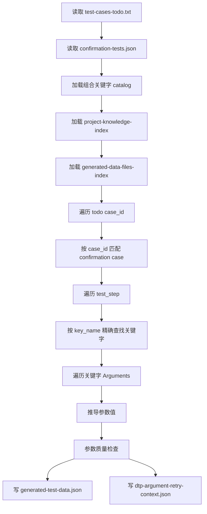

# DTP 关键字参数推导设计文档

## 1. 设计定位

DTP 关键字参数推导是用例级数据生成阶段的核心能力。

它负责把 A 同学生成的确认测试用例数据、待执行用例列表、DTP 组合关键字定义、项目级数据文件索引和项目知识索引，转换成 Robot 脚本生成阶段可直接消费的结构化步骤数据。

输出文件是：

```text
.matrix/data/generated-test-data.json
```

如果参数质量存在问题，还会输出：

```text
.matrix/data/dtp-argument-retry-context.json
```

这部分逻辑不直接生成 `.robot`，也不负责选择关键字。Robot 脚本生成阶段只消费本阶段产出的 `generated-test-data.json`。

## 2. 职责边界

### 2.1 本阶段负责

- 读取 `.matrix/data/test-cases-todo.txt`。
- 读取 `.matrix/data/confirmation-tests.json`。
- 按 `case_id` 找到待生成的测试用例。
- 按步骤中的 `key_name` 精确查找组合关键字。
- 读取组合关键字 `.txt` 和 `.json` 定义。
- 根据关键字参数定义生成 Robot 参数值。
- 优先复用 `.matrix/data/generated-data-files-index.json` 中已有数据文件。
- 必要时生成 case-specific supplemental data file。
- 对每个步骤做参数质量检查。
- 写出 `generated-test-data.json`。
- 写出 `dtp-argument-retry-context.json`。

### 2.2 本阶段不负责

- 不生成项目级全量协议数据文件。
- 不从文档重新全量理解所有协议，除非补充文件生成需要复用项目知识。
- 不做模糊关键字选择。
- 不修改 A 同学输出的原始测试用例。
- 不生成 `.robot` 文件。
- 不读取 `.matrix/data/DTPProject/V1/测试用例` 作为输入。

## 3. 入口和代码位置

入口工具：

```text
dtp_test_data_generate
```

核心代码：

```text
src/tools/dtp-case-test-data-generator.ts
src/tools/dtp-data-generation-core.ts
runDtpCaseDataInstantiation()
buildGeneratedStep()
```

关键函数：

```text
loadTodoCaseIds()
loadConfirmationCases()
loadKeywordCatalog()
buildGeneratedStep()
generateDataFile()
findDataFileIndexEntry()
validateGeneratedStepArguments()
buildArgumentRetryContext()
```

## 4. 输入数据

### 4.1 待执行用例列表

路径：

```text
.matrix/data/test-cases-todo.txt
```

格式：

```text
TC-GN-001
TC-GN-002
TC-GN-003
```

规则：

- 每个非空行表示一个待执行 `case_id`。
- 只生成列表中出现的用例。
- 如果某个 `case_id` 在 `confirmation-tests.json` 中不存在，则记录 warning。

### 4.2 确认测试用例数据

路径：

```text
.matrix/data/confirmation-tests.json
```

关键字段：

```json
{
  "case_id": "TC-GN-001",
  "case_name": "用例名称",
  "test_purpose": "测试目的",
  "requirement_ids": ["REQ-001"],
  "test_step": [
    {
      "key_name": "发送CANA数据_数据文件",
      "step_desc": "步骤描述",
      "parameter": [],
      "expected_result": "预期结果"
    }
  ]
}
```

当前代码兼容旧字段别名，但推荐使用：

```text
key_name
step_desc
parameter
expected_result
```

字段使用原则：

- `key_name` 是关键字精确名称。
- `step_desc` 用于业务语义匹配。
- `expected_result` 用于补充语义匹配。
- `parameter` 中只有 `${time}` 被直接信任。
- 非 `${time}` 参数只作为 hint，不直接照搬。

### 4.3 组合关键字定义

路径：

```text
.matrix/data/DTPProject/组合关键字
```

每个关键字通常有成对文件：

```text
发送CANA数据_数据文件.txt
发送CANA数据_数据文件.json
```

`.txt` 用于保留 Robot 关键字实现，`.json` 用于读取参数列表和参数说明。

参数定义示例：

```json
{
  "Name": "发送CANA数据_数据文件",
  "Arguments": [
    {
      "Name": "${time}",
      "Comments": "执行时间"
    },
    {
      "Name": "${para1}",
      "Comments": "参数1：ID:0~255，一个ID对应一种类型指令"
    },
    {
      "Name": "${para2}",
      "Comments": "参数2：数据文件，文件内容为十六进制数据"
    },
    {
      "Name": "${para3}",
      "Comments": "参数3：循环时间，单位为秒"
    }
  ]
}
```

参数推导主要依赖 `Arguments[].Comments`，而不是 `${para1}`、`${para2}` 这种占位符名称本身。

### 4.4 项目级数据文件索引

路径：

```text
.matrix/data/generated-data-files-index.json
```

作用：

- 记录项目级预生成的数据文件。
- 记录 supplemental 动态生成的数据文件。
- 为文件参数和协议名参数提供候选匹配。

关键字段：

```json
{
  "requested_file_name": "间接指令-X2-关机.txt",
  "protocol_name": "间接指令-X2-关机",
  "file_path": "输入数据\\\\输入流\\\\间接指令-X2-关机.txt",
  "absolute_file_path": "...",
  "generation_basis": [],
  "checksum_rule": "...",
  "field_value_plan": [],
  "flow_direction": "input",
  "confidence": 0.9,
  "state": "generated"
}
```

### 4.5 项目知识索引

路径：

```text
.matrix/data/project-knowledge-index.json
```

作用：

- 当 case 需要 supplemental data file 时，提供文档知识上下文。
- 为 trace、basis、fallback 说明提供来源。

## 5. 总体流程



## 6. 关键字匹配设计

### 6.1 精确匹配

当前设计不做模糊关键字选择。

规则：

- 从步骤中读取 `key_name`。
- 到 `KeywordCatalog` 中按完全一致名称查找。
- 找不到则记录：

```text
Keyword not found: <key_name>
```

原因：

- A 同学上游流程已经负责生成关键字名称。
- 本阶段如果再做模糊匹配，容易把业务步骤绑定到错误关键字。
- 参数推导依赖关键字参数定义，关键字错了会导致后续参数全部错。

### 6.2 关键字 catalog 加载

加载目录：

```text
.matrix/data/DTPProject/组合关键字
```

加载规则：

- 以同名 `.txt` 和 `.json` 配对。
- 缺少任意一边则不进入 catalog。
- `.json` 解析 `Arguments`。
- `.txt` 保留原始关键字实现和 documentation。

## 7. 参数推导核心原则

### 7.1 只直接信任 `${time}`

当前明确约定：上游参数中最多只有一个可信参数，即 `${time}`。

处理规则：

- 如果参数名是 `${time}`，从 step 中提取时间值。
- 如果时间缺失，记录 warning。
- 成功时生成 resolved argument：

```json
{
  "name": "${time}",
  "value": 1.1,
  "semantic": "time",
  "source": "confirmation-tests.json",
  "confidence": 1
}
```

### 7.2 不信任非 time 上游参数

非 `${time}` 参数不直接使用 `confirmation-tests.json` 中的值。

原因：

- A 同学当前主要给的是关键字名称、步骤描述、时间序列和可能的数据文件名称 hint。
- 数据文件内容在 A 同学输出时通常还不存在。
- 非 time 参数需要结合关键字定义和项目级数据文件索引重新推导。

### 7.3 参数语义来自关键字说明

参数语义判断优先看：

```text
Arguments[].Comments
```

例如：

```text
参数2：数据文件，文件内容为十六进制数据
```

这类参数会被识别为文件参数。

例如：

```text
参数：协议名
```

这类参数会尝试从匹配到的数据文件名称中推导协议名。

## 8. 参数分类和推导策略

### 8.1 时间参数

识别条件：

```text
argument.name === "${time}"
```

来源：

```text
confirmation-tests.json
```

输出语义：

```text
time
```

质量要求：

- 必须存在。
- 应能被解析为有效时间。

### 8.2 文件参数

识别依据：

- 参数 comments 中包含“数据文件”“文件”等语义。
- 代码通过 `argumentLooksLikeFile()` 判断。

推导流程：

1. 从 step 中提取 requested file name hint。
2. 组合语义文本：

```text
step_desc + expected_result + test_purpose
```

3. 优先调用 `findDataFileIndexEntry()` 在 `generated-data-files-index.json` 中匹配。
4. 如果匹配成功，直接复用索引中的 file path。
5. 如果匹配失败，调用 `generateDataFile()` 生成 supplemental file。
6. 将生成或匹配结果写入 `generated_data_files`。
7. 将 Robot 参数值设置为文件路径。

输出示例：

```json
{
  "name": "${para2}",
  "value": "输入数据\\\\输入流\\\\间接指令-X2-关机.txt",
  "semantic": "file_path",
  "source": "generated-data-file",
  "confidence": 0.6
}
```

### 8.3 协议名参数

识别依据：

- 参数 comments 被识别为 `protocol_name`。

推导流程：

1. 复用 step 语义文本。
2. 从 `generated-data-files-index.json` 中匹配数据文件。
3. 如果匹配成功，取 `requested_file_name` 去掉 `.txt` 后作为协议名。
4. 如果 `requested_file_name` 不可用，则使用 `protocol_name`。

输出示例：

```json
{
  "name": "${para1}",
  "value": "间接指令-X2-关机",
  "semantic": "protocol_name",
  "source": "generated-data-files-index",
  "confidence": 0.9
}
```

### 8.4 其他普通参数

对于无法归类为 time、file path、protocol name 的参数，会尝试从上下文推导。

可用上下文包括：

- 关键字参数 comments。
- step description。
- expected result。
- test purpose。
- docsContext。

如果仍无法推导：

```text
Unresolved argument <argument_name> for keyword <keyword_name>
```

该问题会进入参数质量检查和 retry context。

## 9. 数据文件索引匹配设计

核心函数：

```text
findDataFileIndexEntry()
```

输入：

```text
GeneratedDataFileIndex
requestedFileName
semanticText
```

匹配策略：

### 9.1 直接名称匹配

候选 key：

- `requested_file_name`
- `protocol_name`
- `file_path`

会做 normalize 后比较：

- 完全相等。
- entry 包含 requested。
- requested 包含 entry。

### 9.2 语义文本匹配

将 step 描述、预期结果、测试目的合并成语义文本，与数据文件索引中的文件名和协议名比较。

适用于：

- A 同学只给了自然语言描述。
- 数据文件名和描述之间存在部分重叠。

### 9.3 协议关键词归一化

匹配前会去掉一些泛化词：

```text
正确
错误
通过
总线
发送
输入
输出
间接指令
控制指令
测试指令
指令
软件
数据文件
文件
```

这样可以提升“业务实体名”的匹配权重。

### 9.4 最长公共子串匹配

当直接包含关系不成立时，会计算最长公共子串。

阈值：

- requested overlap >= 4 时可作为强候选。
- semantic overlap >= 6 时可作为语义候选。

### 9.5 匹配结果

返回最高分候选。

如果没有候选，返回 `null`，后续进入 supplemental 文件生成。

## 10. Supplemental Data File 生成

当文件参数找不到已有数据文件时，会调用：

```text
generateDataFile()
```

生成策略：

- 根据 step context 派生 requested name。
- 默认落到输入流目录。
- 写入 `.matrix/data/DTPProject/V1/输入数据/输入流`。
- 同步追加到 `generated-data-files-index.json`。

当前 supplemental 生成是兜底能力，不应替代项目级全量数据文件生成。

输出 metadata 会记录：

- `content_generation_required`
- `requested_file_name`
- `file_path`
- `generation_basis`
- `checksum_rule`
- `flow_direction`
- `source_file_state`
- `format_notes`

如果没有解析到项目需求文档，会记录 warning，提示需要人工核查。

## 11. 参数质量检查

核心函数：

```text
validateGeneratedStepArguments()
```

质量结果：

```json
{
  "status": "pass | warning | failed",
  "expected_argument_count": 4,
  "actual_argument_count": 4,
  "issues": []
}
```

### 11.1 参数个数检查

检查：

- 关键字定义中有多少参数。
- 实际解析出多少参数。

问题类型：

```text
argument_count_mismatch
```

### 11.2 缺失参数检查

检查每个 required argument 是否都有 resolved argument。

问题类型：

```text
missing_argument
```

### 11.3 时间合法性检查

检查 time 参数是否存在且合法。

问题类型：

```text
invalid_time
```

### 11.4 文件路径检查

检查 file path 参数格式是否合理。

问题类型：

```text
invalid_file_path
```

### 11.5 文件 artifact 检查

检查对应数据文件是否存在，或者是否已经在 generated data files 中记录。

问题类型：

```text
missing_file_artifact
```

### 11.6 低置信度检查

当参数来源不稳定或 confidence 偏低时记录问题。

问题类型：

```text
low_confidence
```

## 12. Retry Context 设计

当参数质量不是 pass 时，会生成：

```text
.matrix/data/dtp-argument-retry-context.json
```

核心函数：

```text
buildArgumentRetryContext()
```

收集范围：

- 只收集存在参数质量问题的 step。
- 不重新收集全部 case。
- 附带当前 resolved arguments。
- 附带 generated data files。
- 附带候选 data files。

输出结构：

```json
{
  "schema_version": "1.0.0",
  "status": "ready",
  "source_data_file": ".matrix/data/confirmation-tests.json",
  "generated_data_files_index_file": ".matrix/data/generated-data-files-index.json",
  "cases": [
    {
      "case_id": "TC-GN-001",
      "steps": [
        {
          "step_index": 1,
          "keyword_name": "发送CANA数据_数据文件",
          "argument_quality": {},
          "keyword_arguments": [],
          "resolved_arguments": [],
          "generated_data_files": [],
          "candidate_data_files": []
        }
      ]
    }
  ],
  "warnings": []
}
```

用途：

- 给后续局部参数修复提供小上下文。
- 避免重新生成未受影响的 case。
- 方便人工排查哪个参数没推出来。

## 13. 输出设计

### 13.1 `generated-test-data.json`

路径：

```text
.matrix/data/generated-test-data.json
```

核心结构：

```json
{
  "schema_version": "1.0.0",
  "project_name": "project",
  "source_files": {
    "todo_file": ".matrix/data/test-cases-todo.txt",
    "confirmation_tests_file": ".matrix/data/confirmation-tests.json",
    "keyword_dir": ".matrix/data/DTPProject/组合关键字",
    "generated_data_files_index": ".matrix/data/generated-data-files-index.json",
    "argument_retry_context": ".matrix/data/dtp-argument-retry-context.json",
    "project_root": "..."
  },
  "cases": [],
  "warnings": []
}
```

每个 case：

```json
{
  "case_id": "TC-GN-001",
  "case_name": "用例名称",
  "test_purpose": "测试目的",
  "requirement_ids": [],
  "generated_steps": [],
  "warnings": []
}
```

每个 step：

```json
{
  "step_index": 1,
  "keyword_name": "发送CANA数据_数据文件",
  "step_description": "步骤描述",
  "expected_result": "预期结果",
  "keyword_arguments": [],
  "resolved_arguments": [],
  "generated_data_files": [],
  "argument_quality": {},
  "warnings": [],
  "trace_notes": []
}
```

### 13.2 Robot 脚本生成消费方式

Robot 脚本生成阶段只需要读取：

```text
.matrix/data/generated-test-data.json
```

并使用其中：

- `keyword_name`
- `resolved_arguments`
- `generated_data_files`
- `warnings`

Robot 阶段不应再重新推导业务参数。

## 14. 当前设计评价

当前关键字参数推导设计总体是合理的。

合理点：

- 明确只信任 `${time}`，避免上游非结构化参数污染执行参数。
- 不做模糊关键字选择，降低错绑关键字风险。
- 参数语义来自关键字定义，而不是 `${para1}` 这种无语义占位符。
- 文件参数优先复用项目级数据文件索引。
- 协议名参数从匹配到的数据文件 stem 推导，保证和文件一致。
- 有参数质量检查，不会静默产出错误参数。
- 有 retry context，支持局部修复。

仍需关注：

- `findDataFileIndexEntry()` 目前是规则匹配，复杂语义匹配仍可能误选。
- supplemental file 默认落输入流，复杂场景可能需要结合文档判断输入/输出。
- 普通参数推导能力目前偏保守，更多依赖关键字 comments 和上下文。
- 参数质量报告可以继续细化，例如区分“可执行但需人工核查”和“不可执行”。

## 15. 后续优化建议

### 15.1 增加参数推导性能报告

当前已有数据生成性能报告，后续可以增加参数推导统计：

- case 数量。
- step 数量。
- 参数总数。
- unresolved 参数数。
- 文件参数命中索引次数。
- supplemental 文件生成次数。
- argument_quality 失败分布。

### 15.2 增强候选文件排序

可以在 `candidate_data_files` 中增加：

- 命中原因。
- 命中分数。
- 命中的 step 文本片段。
- 是否同 flow_direction。

### 15.3 引入局部模型修复

当参数质量失败时，不建议重新跑全量数据生成。

更合适的是：

- 只读取 `dtp-argument-retry-context.json`。
- 只修复失败 step。
- 修复后重新验证参数质量。

### 15.4 明确 supplemental 文件生成边界

后续可以要求 supplemental 文件生成也必须：

- 标明输入流或输出流判断依据。
- 记录关联协议定义。
- 记录是否来自项目级协议定义。
- 在低置信度时要求 warning 或人工确认。

## 16. 排查建议

如果生成的 Robot 参数不对，建议按以下顺序检查：

1. `confirmation-tests.json` 中该 step 的 `key_name` 是否正确。
2. `组合关键字` 中是否存在对应 `.txt/.json`。
3. 关键字 `.json` 中 `Arguments[].Comments` 是否能表达参数语义。
4. `generated-data-files-index.json` 中是否存在期望数据文件。
5. `generated-test-data.json` 中 `resolved_arguments` 的 source 和 confidence。
6. `argument_quality.issues` 是否有错误或 warning。
7. `dtp-argument-retry-context.json` 中是否列出了该 step。

