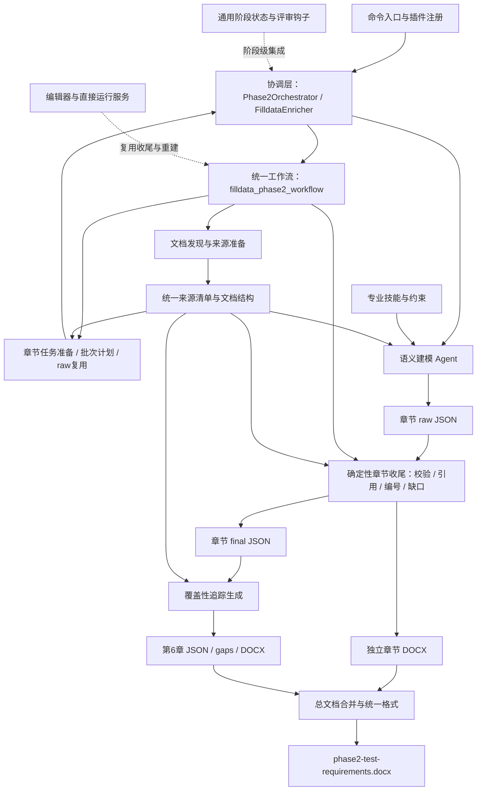
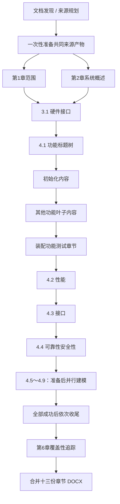

# Phase 2 测试需求生成整体架构

## 1. 架构定位与边界

Phase 2 的核心是文档驱动的测试需求生成：从项目需求文档建立统一来源，再由专业语义建模 Agent 生成分章节中间结果，由确定性工具完成校验、编号、章节发布、覆盖性追踪和总文档合并。

完整文档生成入口是 `/matrix-phase2`，最终产物为 `.matrix/reports/phase2-test-requirements.docx`。它包含第 1 章范围、第 2 章系统概述、3.1 硬件接口、4.1～4.9 测试需求和第 6 章测试需求覆盖性说明，共十三份独立章节 DOCX。

需要区分以下入口边界：

| 入口 | 协调者 | 当前职责范围 |
| --- | --- | --- |
| `/matrix-phase2` | `phase2-orchestrator` | 完整分章节生成、追踪表和总 DOCX 合并 |
| 独立章节命令 | `filldata-enricher` 等章节协调器 | 共用新 Phase 2 工作流，生成指定章节 |
| `/matrix-review` | `reviewer` | 评审章节数据、来源证据、覆盖追踪和完整文档 |

当前 `src/shared/constants.ts` 中 Phase 2 的阶段依赖是 Phase 0，不依赖 Phase 1 或 Phase 1b。文档生成主链路明确不读取 `software-analysis.json`；项目配置可以提供可选元数据。

## 2. 整体模块架构

主要职责：

1. **协调层**决定何时调用工作流、何时委派 worker、哪些任务可以并行以及失败时何时停止。
2. **语义层**依据原始需求和专业技能进行内容理解与需求建模，输出 raw JSON。
3. **确定性工具层**管理来源、任务计划、数据契约、编号、引用绑定、章节渲染和总文档合并。
4. **支撑层**提供类型与 Schema、追踪引用、复用、编辑映射以及通用阶段治理。

工作流返回任务与提示词，协调 Agent 通过 `task` 发起语义 worker；工作流本身不是自主调用大模型的调度器。

## 3. 模块职责与代码位置

代码路径相对于仓库根目录。

### 3.1 入口注册与协调

| 模块 | 作用 | 代码位置 |
| --- | --- | --- |
| 插件组装与注册 | 将命令、Agent、工具和技能接入 OpenCode | `src/index.ts`、`src/plugin-interface.ts`、`src/create-tools.ts`、`src/create-skills.ts`、`src/create-agents.ts`、`src/agents/builtin-agents.ts` |
| 文档需求协调器 | 驱动独立章节命令，共用新 Phase 2 工作流 | `src/agents/filldata-enricher.ts` |
| 完整文档协调器 | 驱动完整 Phase 2 文档流程，管理章节顺序、并行分组、复用和停止条件 | `src/agents/phase2-orchestrator.ts` |
| 项目总协调器 | 在整个测试项目中调度 Phase 2 及其评审 | `src/agents/conductor.ts` |
| 统一工作流入口 | 通过 `mode` 分派文档准备、硬件接口、功能需求、各章节收尾、追踪和总文档合并 | `src/tools/filldata-phase2-workflow.ts` |

### 3.2 文档来源与证据模块

| 模块 | 作用 | 代码位置 |
| --- | --- | --- |
| 文档发现与来源规划 | 在项目目录内发现文档，由语义规划器选择主 SRS 与补充文档 | `src/tools/filldata-phase2-workflow.ts`、`src/agents/source-planner.ts` |
| 文档解析与结构化 | 抽取段落、目录、章节结构和原表资源，生成来源产物 | `src/tools/filldata-parser.ts`、`src/tools/document-structure-artifact.ts` |
| 来源清单与统一读取 | 通过 `source-artifacts.json` 汇集主文档和补充文档，为章节提供统一结构、正文、表格与引用索引 | `src/tools/phase2-source-bundle.ts` |
| 来源质量报告 | 汇总文档结构及抽取质量问题，供排查来源问题 | `src/tools/document-quality-report.ts` |
| 来源引用约束 | 统一来源引用格式与提示约束，支持生成结果回溯到原文 | `src/schema/phase2-source-ref.ts`、`src/shared/phase2-source-ref-guidance.ts` |

来源准备同时保留 segments、toc 和 document structure；章节语义建模以来源清单指向的 **document structure** 为正文与表格依据，不能将段落文件或目录文件等同于章节建模输入。

### 3.3 分章节语义建模与生成模块

各章节普遍采用 `prepare → worker 写 raw → finalize` 契约。`prepare` 检查前置产物、判断复用并提供任务；worker 负责语义；`finalize` 负责形成可发布产物。

| 文档部分 | 模块作用 | 语义 Agent（`src/agents/` 下） | 工作流代码（`src/tools/` 下） |
| --- | --- | --- | --- |
| 第 1 章范围 | 生成软件、项目与文档范围信息 | `chapter1-scope-modeler.ts` | `chapter1-scope-workflow.ts` |
| 第 2 章系统概述 | 生成系统背景与整体说明 | `chapter2-system-overview-modeler.ts` | `chapter2-system-overview-workflow.ts` |
| 3.1 硬件接口 | 发现接口候选，分接口建模、合并并绑定来源表格 | `hardware-interface-discoverer.ts`、`hardware-interface-modeler.ts` | `filldata-phase2-workflow.ts` |
| 4.1 功能测试 | 建立功能标题树，生成初始化与其他功能叶子内容，按标题树装配章节 | `functional-title-tree-modeler.ts`、`functional-init-content-modeler.ts`、`functional-other-content-modeler.ts` | `filldata-phase2-workflow.ts` |
| 4.2 性能测试 | 提取可验收的性能测试需求 | `performance-test-content-modeler.ts` | `performance-test-workflow.ts` |
| 4.3 接口测试 | 发现接口标识，按接口准备任务并生成测试需求 | `interface-test-identifier-discoverer.ts`、`interface-test-content-modeler.ts` | `interface-test-workflow.ts` |
| 4.4 可靠性安全性测试 | 生成可靠性与安全性测试需求 | `reliability-safety-test-content-modeler.ts` | `reliability-safety-test-workflow.ts` |
| 4.5 余量测试 | 生成余量相关需求 | `margin-test-content-modeler.ts` | `margin-test-workflow.ts` |
| 4.6 边界测试 | 生成边界与端点相关需求 | `boundary-test-content-modeler.ts` | `boundary-test-workflow.ts` |
| 4.7 数据处理测试 | 生成数据处理相关需求 | `data-processing-test-content-modeler.ts` | `data-processing-test-workflow.ts` |
| 4.8 恢复性测试 | 生成故障恢复相关需求 | `recovery-test-content-modeler.ts` | `recovery-test-workflow.ts` |
| 4.9 强度测试 | 生成压力、过载等相关需求 | `strength-test-content-modeler.ts` | `strength-test-workflow.ts` |

3.1 是硬件接口背景与结构建模，4.3 是接口测试需求生成，二者是不同模块。4.1 的标题树负责章节骨架，初始化和其他功能结果负责填充内容；初始化在完整流程中是必需项。

### 3.4 技能与数据契约

| 模块 | 作用 | 代码位置 |
| --- | --- | --- |
| 来源与接口建模技能 | 为来源选择、通用硬件接口及 CAN、串口、AD、看门狗、1553B 等专业接口提供语义规则 | `skills/source-plan-analysis/`、`skills/hardware-interface-modeling/`、`skills/hardware-interface-dataflow-constraints/`、`skills/*-interface-analysis/` |
| 功能需求技能 | 规定标题树、初始化、其他功能的生成方法 | `skills/functional-title-tree/`、`skills/functional-init-requirements/`、`skills/functional-other-requirements/` |
| 分类测试需求技能 | 为性能、接口、可靠性安全性、余量、边界、数据处理、恢复性、强度等分类提供规则 | `skills/performance-test-requirements/`、`skills/interface-test-requirements/`、`skills/reliability-safety-test-requirements/` 等对应目录 |
| 章节数据契约 | 定义 raw、正式章节数据、缺口和追踪表结构；部分功能契约位于统一工作流中 | `src/schema/phase2-hardware-raw.ts`、`src/schema/chapter1-scope.ts`、`src/schema/chapter2-system-overview.ts`、`src/schema/*-test-content.ts`、`src/schema/functional-test-traceability.ts`、`src/tools/filldata-phase2-workflow.ts` |
| JSON 读取、容错与诊断 | 读取模型产物，进行兼容处理并记录告警；容错并不替代章节业务检查 | `src/shared/phase2-json.ts`、`src/shared/phase2-tolerance.ts` |
| 稳定需求编号 | 由确定性代码分配和维护需求标识 | `src/shared/phase2-stable-ids.ts` |

技能提供语义生成规则，Schema 和收尾代码负责结构与可确定检查。两者的约束强度不同，不能认为每条提示词规则都有对应硬校验。

### 3.5 追踪、文档发布与编辑支撑

| 模块 | 作用 | 代码位置 |
| --- | --- | --- |
| 章节 DOCX 渲染 | 将正式章节数据转换成独立 DOCX，硬件接口可复用原表资源 | `src/tools/hardware-interface-docx.ts`、`src/tools/functional-*-docx.ts`、`src/tools/chapter1-scope-docx.ts`、`src/tools/chapter2-system-overview-docx.ts`、各类 `*-test-content-docx.ts` |
| 覆盖性追踪 | 将 4.1～4.9 的需求编号与主 SRS 有效数字章节关联，输出追踪表与缺口；同时记录第 1、2 章来源引用 | `src/tools/functional-test-traceability-workflow.ts`、`src/tools/functional-test-traceability-docx.ts` |
| 总文档合并 | 检查十三份章节 DOCX，合并内容与资源并应用封面和统一格式 | `src/tools/phase2-document-workflow.ts`、`src/tools/test-requirements-docx-format.ts`、`templates/phase2-test-requirements-cover.docx` |
| DOCX 公共基础设施 | 支撑文档打包、标题、样式、表格与资源处理 | `src/tools/docx-*.ts` |
| 编辑映射与人工修订 | 将展示内容对应到 raw 来源，支持人工修改后重新生成确定性结果 | `src/shared/phase2-edit-mapping.ts`、`src/tools/phase2-editor.ts`、`src/tools/phase2-editor-mapping.ts` |
| 直接运行服务 | 提供 HTTP 编辑和确定性收尾接口，复用既有工作流，不承担初始语义建模 | `src/direct-phase2-runner.ts` |

## 4. 模块间的主要交互

### 4.1 单章节交互契约

协调器调用 `prepare`，工作流检查前置产物与 raw 复用条件，返回待生成任务、输出位置与复用状态。需要建模时，协调器原样传递 `worker_prompt`，worker 读取来源与技能并写 raw；复用项跳过 worker。随后调用 `finalize`，由工具读取 raw，完成校验、规范化和章节发布。

模块通过 `.matrix/` 文件产物交换数据，工具返回值传递 worker 类型、批次索引、任务提示和执行状态。失败时停止后续步骤，已成功产物保留供续跑。

### 4.2 完整文档流程与并行边界

- 第 1、2 章是共同来源准备后的两个独立分支；两章都成功后进入 3.1。
- 硬件接口以 wave 分组，功能其他叶子和接口测试以批次分组；每组最多五个 worker，组内并行、组间串行。
- 4.5～4.9 依次准备，未复用的单 raw worker 同时执行；全部成功后按章节顺序收尾。
- 章节或 worker 失败、输出缺失或 raw 无效时停止相关后续步骤，保留已成功 raw 供续跑。
- 覆盖性追踪和总文档合并是确定性步骤，不委派语义 worker。

这些是完整文档协调器规定的执行顺序，应与项目级 Phase DAG 区分。独立章节命令仍需满足各自 `prepare` 检查的前置条件。

## 5. 核心数据流与产物

| 层次 | 代表产物 | 提供给谁 |
| --- | --- | --- |
| 文档候选与来源计划 | `.matrix/data/phase2-document-candidates.json`、`source-plan.json` | 来源准备模块 |
| 统一来源 | `.matrix/data/source-artifacts.json`、`req-document-structure.json`、补充文档结构及原表资源 | 各章节任务准备、语义 worker、引用绑定与追踪模块 |
| 任务计划 | 硬件接口候选与批次、功能标题树与叶子 worker manifest、接口测试 plan | 协调器及分章节 worker |
| 语义中间结果 | 各章节 `*.raw.json`、接口分块 raw、功能叶子 raw | 确定性收尾模块与编辑模块 |
| 正式章节数据 | `chapter1-scope.json`、`chapter2-system-overview.json`、`hardware-interface-model.json`、`functional-test-content.json`、各分类 `*-test-content.json` | DOCX 渲染、追踪、编辑 |
| 质量与缺口 | 文档质量报告、章节 gaps、收尾告警 | 人工检查、修订与运行汇报 |
| 覆盖性追踪 | `phase2-test-traceability.json`、`phase2-test-traceability-gaps.json` | 第 6 章渲染与覆盖性检查 |
| 发布文档 | `.matrix/reports/` 下十三份独立章节 DOCX 与 `phase2-test-requirements.docx` | 用户和后续文档使用方 |

`source_ref` 连接原始需求与生成内容，`requirement_id` 标识正式测试需求，原表 `table_id` / `table_asset` 连接生成章节与来源表格。它们分别支撑来源证据、需求身份和原文表格复用。

raw 是模型输出边界，final JSON 是确定性规范化后的章节边界，DOCX 是发布边界。总文档合并读取章节 DOCX，不应将其理解为再次对全部来源进行大模型生成。

## 6. 复用与人工修订机制

`prepare` 会按对应章节规则检查已有 raw，返回 `raw_reused` 或 `incremental_reuse` 等状态。协调器只调度返回的待生成任务，复用项不占并行槽位；复用后仍调用收尾步骤生成正式结果。

这里的复用判断是各模块定义的有效性检查，不能笼统认为它保证所有上游文档变更都被自动识别。来源更新后是否应重建，需要结合对应模块的复用条件理解。

人工修订通过编辑映射回到 raw，再复用确定性收尾、追踪和总文档生成能力。直接运行服务提供这条修订与重建路径，构成主生成流程的配套能力。

## 7. 阶段治理与下游边界

### 7.1 项目级阶段集成

`conductor` 的 Phase 2 指引使用 `phase2-orchestrator` 生成完整文档，再交由 `reviewer` 审查章节数据、来源证据和覆盖追踪，输出 `reviews/req-review.json`。文档合并成功与评审通过是两个独立条件。

通用阶段机制位于 `src/shared/phase-state.ts` 和 `src/hooks/`，负责 DAG、访问门禁、进度、评审提醒与产物校验。当前仍有两处衔接限制：

- `src/shared/constants.ts` 的 Phase 2 默认 Agent 仍为 `filldata-enricher`，与完整文档入口及 Conductor 的指引不同。
- `progress-tracker.ts` 的 Phase 2 产物识别仍使用 `test-requirements.json`；不能据此认为新总 DOCX 已自动触发待评审状态。

章节内部的 `prepare/finalize` 校验不替代这些项目级机制。

### 7.2 保留的下游能力

本次清理删除旧 V1 分类、语义批次合并、统一需求生成和第三方导出链路，以及对应的独立命令、Agent、Schema、模板与专属测试。新 Phase 2 的来源抽取、章节生成、编辑重建、追踪和总文档合并继续保留。

单元测试用例生成及 Phase 6 的生成、审查、发布和执行能力均保留，包括 `/matrix-test`、`/matrix-dynamic-design` 和 `/matrix-dynamic-test`。它们仍使用现有需求输入和追踪契约；`src/schema/test-requirement.ts`、`src/shared/test-requirements.ts` 及 `test-requirements.json` 的产物校验继续保留。用例 DOCX 工具也仍可读取该需求文件进行排序。

新 Phase 2 发布章节 JSON/DOCX 和总文档，**不生成下游所需的 flat `test-requirements.json`**。当前没有新增格式转换；启动相关下游流程前应验证该输入存在且有效，缺失时报告输入缺口。章节 JSON、总 DOCX 和 flat 需求文件是不同的产物契约。
