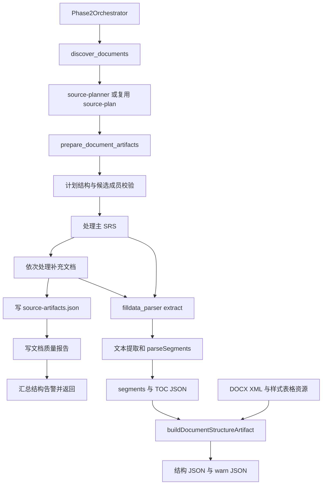

# Phase 2 共同来源准备：文档解析与章节切片

本文依据当前工作区实现，说明 `filldata_phase2_workflow mode="prepare_document_artifacts"` 的执行路径。范围截止于来源清单、章节结构和表格资源生成；后续测试需求建模只作为消费者说明。

核心结论：该入口先处理主 SRS，再串行处理补充文档。文档先转为文本并按标题分段；DOCX 还会重新读取原始 XML，把正文、表格与章节对齐。这里没有按 token、固定字符数或重叠窗口切片，也没有用大模型识别章节。语义 Agent 只在此前选择来源，以及此后生成需求时参与。

## 1. 入口、前置条件与完整调用链

### 1.1 “一次性准备”的含义

`phase2-orchestrator` 在文档发现与来源规划完成后调用一次 `prepare_document_artifacts`，供第 1、2 章、3.1 和 4.1～4.9 共用。它表示一次调用准备整组来源，既不是文档并行解析，也不是永久缓存保证。再次调用此 mode 会重新抽取所选文档并覆盖对应产物。

入口实现见 [src/tools/filldata-phase2-workflow.ts](../src/tools/filldata-phase2-workflow.ts) 中的 `executePrepareDocumentArtifactsMode` 函数；协调顺序见 `src/agents/phase2-orchestrator.ts`。

### 1.2 前置文档发现与来源规划

`discover_documents` 在当前项目目录递归收集 `.pdf`、`.doc`、`.docx`、`.txt`，按路径 `localeCompare` 排序，写 `phase2-document-candidates.json`。发现范围由 `resolveDocumentRootPath` 限定：拒绝磁盘根目录及项目目录外的扫描路径。跳过 `.git`、`.matrix`、`node_modules`、`dist`、`coverage`、`$RECYCLE.BIN`、`System Volume Information`，并忽略以 `~$` 开头的 Word 临时文件；目录读取遇到 `EPERM/EACCES/ENOENT` 时跳过。

这些是目录名精确比较，并非通用忽略规则引擎。`.md` 不在此发现列表中，虽然底层解析器能读取 Markdown。

发现后，`source-planner` 根据候选文件确定唯一主 SRS 与补充文件，写：

```json
{
  "primary_srs_path": "D:/project/requirements.docx",
  "other_document_paths": ["D:/project/protocol.docx"]
}
```

已有计划只要通过 `readSourcePlanArtifact` 的基本结构检查，发现步骤就可能返回 `incremental_reuse=true`；此时不会验证其路径仍在最新候选清单内。**真正的候选成员校验在来源准备入口进行**，所以“发现时可复用”不等于“准备时一定可用”。

代码：[src/tools/filldata-phase2-workflow.ts](../src/tools/filldata-phase2-workflow.ts) 中的 `walkDocumentFiles` 函数、[src/tools/filldata-phase2-workflow.ts](../src/tools/filldata-phase2-workflow.ts) 中的 `executeDiscoverDocumentsMode` 函数、[src/tools/filldata-phase2-workflow.ts](../src/tools/filldata-phase2-workflow.ts) 中的 `readSourcePlanArtifact` 函数。

### 1.3 来源准备的执行顺序

1. 计算候选清单、计划、主文档 segments/TOC/structure、来源清单、质量报告与资源目录的默认路径。
2. 检查候选清单、来源计划文件存在。读取计划，要求主路径为非空字符串，补充路径为字符串数组；缺省补充列表视为空。
3. `validateSourcePlanAgainstCandidates` 按路径字符串检查主文档及每个补充文档均为候选成员；不允许主文档在补充列表重复，也不允许补充路径重复。不是按文件内容去重。
4. `await prepareDocumentArtifacts(primary)`，完整处理主文档。
5. 创建 `supporting-sources`，按计划中的数组顺序逐个 `await prepareDocumentArtifacts(other)`，不并行。
6. 组装并写 `source-artifacts.json`。
7. 对全部原始文件执行质量检查，写 `document-quality-report.md`。
8. 读取各结构诊断文件的 `warning_count` 并求和，返回清单路径、质量报告路径和结构告警总数。



### 1.4 单份文件的处理

[src/tools/filldata-phase2-workflow.ts](../src/tools/filldata-phase2-workflow.ts) 中的 `prepareDocumentArtifacts` 函数 依次执行：

- 后缀为 `.doc` 时立即抛错，要求先转为 `.docx`。发现阶段接受 `.doc` 不代表准备阶段支持直接读取。
- 用 `toSupportedFormat` 映射 `.txt→text`、`.docx→docx`、`.pdf→pdf`。
- 调用 `filldataParser.execute({mode:"extract", file_path, format, write_artifacts:true, segments_path, toc_path})`。
- `invokeFilldataParser` 经 `parseJsonResult` 读取返回 JSON，发现 `error` 字段就抛错。
- 从磁盘读取刚写出的 segments，调用 `buildDocumentStructureArtifact`；传入表格资源目录及当前来源前缀。
- 调用 `writeDocumentStructureArtifacts`，分别写诊断和结构文件。
- 返回原路径、角色、格式、segments/TOC/structure/诊断路径，加入来源清单。

本路径不调用 `build_outline`、`build_toc_anchor_map` 或 `get_segment`，也不生成 worker 批次。它使用的是 `filldata-parser.ts`，不是另一个仍供分析功能使用的 `req-parser.ts`。

## 2. 模块职责与数据交接

| 模块 | 关键函数 | 输入与职责 | 输出 |
| --- | --- | --- | --- |
| `filldata-phase2-workflow.ts` | `executePrepareDocumentArtifactsMode`、`prepareDocumentArtifacts` | 校验计划、安排串行解析、指定各文件路径 | 来源清单、汇总结果 |
| `filldata-parser.ts` | `executeExtractMode`、`parseSegments`、`buildToc` | 按格式提取文本、清洗、识别标题和正文边界 | segments、TOC |
| `docx-heading-numbering.ts` | `extractDocxText`、`findMatchingResolvedHeading`、`advanceSequence` | Mammoth 转换前恢复标题编号并防止重复加前缀 | 含 Markdown 标题的文本 |
| `docx-heading-resolver.ts` | `resolveHeadings`、`extractTopLevelBodyElements`、`extractTablesFromXml` | 从 OOXML 建立标题目录，按顶层元素顺序读正文与表格 | 标题编号、级别、元素、表格草稿 |
| `word-xml-sanitize.ts` | `sanitizePossibleWordXmlText/Line` | 清除泄漏的 Word XML 标签及对象内容 | 可读文本 |
| `document-structure-artifact.ts` | `buildDocumentStructureArtifact`、`buildDocxSectionTables` | 修复章节 ID/路径、绑定正文与表格、生成来源引用 | sections、表格资源与结构告警 |
| `docx-table-html.ts` | `docxTableXmlToHtml` | 从原表 XML 表达文本、横纵合并和嵌套表 | `table_html` |
| `docx-table-xml-sanitize.ts` | `sanitizeDocxTableAssetXml` | 去除外部关系属性及图片/OLE 等媒体对象 | 可独立复用的表格 XML |
| `docx-zip.ts` | `readZip` | 按 ZIP 中央目录读取条目，支持 STORE 与 DEFLATE | 路径到解压 Buffer 的 Map |
| `document-quality-report.ts` | `writeDocumentQualityReport`、`analyzeDocx` | 对原文件进行独立样式、编号和表格位置诊断 | Markdown 质量报告 |
| `phase2-tolerance.ts` | `withPhase2Diagnostics` | 包装工作流的异常、状态与告警 | 对外 JSON 结果 |

`segments` 是初次文本提取结果；`sections` 是供后续建模使用的规范化章节结构。`sections` 仍是平面数组，通过 `level` 和 `section_path_ids/titles` 表达层级，未生成嵌套 `children` 树，也不会凭空补造缺失父章节节点。

## 3. 按格式解析原文

### 3.1 格式选择与错误

[src/tools/filldata-parser.ts](../src/tools/filldata-parser.ts) 中的 `executeExtractMode` 函数 先检查 `file_path` 和文件存在，再选择 PDF、DOCX 或 UTF-8 文件读取。PDF/DOCX 分支由显式 `format` 或后缀判定；来源准备会按后缀传入匹配格式。PDF 与 DOCX 的提取异常分别返回 `PDF extraction failed`、`DOCX extraction failed`；上层将错误转换成准备失败。

### 3.2 DOCX：文本转换与编号恢复

DOCX 的第一条路径用于产生可分段文本，见 [src/tools/docx-heading-numbering.ts](../src/tools/docx-heading-numbering.ts) 中的 `extractDocxText` 函数：

1. Mammoth ZIP/部件解析器定位并读取 numbering/styles，建立编号解析器；该读取失败则直接用带 `DOCX_STYLE_MAP` 的 Mammoth Markdown 转换，并清洗 Word XML。
2. 另外读取 mainDocument、numbering、styles，交给 `resolveHeadings` 建立 OOXML 标题目录；失败则目录置空，不直接终止转换。
3. 在 Mammoth `transformDocument` 中逐段处理。只有样式 ID/名称被 `headingLevelFromStyle` 识别为标题的段落才进入编号前缀处理。
4. 用段落纯文本、级别和前向游标匹配 OOXML 标题。匹配成功且有 label 时，更新游标并补编号前缀。
5. **OOXML 标题目录非空但当前段落未匹配时，不借用其他标题编号，也不推进游标**，保留原段落供后续标题重新对齐。
6. OOXML 标题目录为空时，才尝试样式关联编号解析器与计数器补前缀。
7. Mammoth 完成 Markdown 转换，清洗泄漏 XML 后返回。

#### OOXML 标题识别与编号优先级

[src/tools/docx-heading-resolver.ts](../src/tools/docx-heading-resolver.ts) 中的 `resolveHeadings` 函数 遍历 `w:body` 的顶层元素，仅处理顶层 `w:p`，避免表格内部段落、`w:p/>` 空段落破坏标题位置。段落需有 `w:pPr`；通过 Heading/中文标题/MatrixHeading 样式、样式显示名称及 `outlineLvl` 识别级别。默认允许 outline 0～8 对应级别 1～9；传 `styleOnly` 才限制 outline 分支。

正文“输入流：…”等字段标签、数字/字母列表通常被 `shouldSuppressDocxBodyHeading` 排除；具有显式多级编号如 `5.2.4`、`B.1` 的段落可绕过该抑制，以免真实章节被误删。

编号按以下分支确定：

- 附件/附录字母根先建立独立层级；其下级优先用显式字母编号，否则按附录子级计数推断，避免污染正文数字章号。
- 标题中已有显式编号时优先采用该编号。
- 否则读取段落直接 `numPr`，或样式继承的 numId/ilvl；再尝试编号定义的 paragraphStyleId 关联。
- 根据 abstractNum、层级定义、起始值/覆盖值生成编号。主 OOXML 解析器按 **abstractNumId** 保存序列计数，numId 切换本身不作为重启；父层变化清空更深层，未初始化层级使用覆盖起始值或默认起始值。
- 再尝试标题文本编号；仍没有编号则用通用级别计数器推断。所有已确定的数字编号会同步通用计数器，避免后续无编号标题错误重启到第 1 章。

该主解析器用 `%1/%2/...` 模板替换数字计数，不应与 Mammoth 备用编号器的格式能力混为一谈。备用 `advanceSequence` 按其 `sequenceKey` 计数，支持自身 `formatNumberValue` 的数字、字母、罗马数字等格式；它不是主 OOXML 路径的等价复制。

#### 标题匹配与重复前缀防护

[src/tools/docx-heading-numbering.ts](../src/tools/docx-heading-numbering.ts) 中的 `findMatchingResolvedHeading` 函数 先从游标起向后查找“同级别、规范化标题完全相等”的条目，第一轮不限制为 24 项。第一轮失败，才在前向最多 **24 个候选**内忽略级别做精确标题匹配，用于 Word/WPS 样式级别不一致的情况。规范化会去编号前缀、尾部部分标点、压缩空白并转小写；不是模糊语义相似度。

`paragraphAlreadyStartsWithPrefix` 检查已有数字/字母前缀及附件字母根，避免将 `5.2.4.3. 标题` 再次加成 `5.2.4.3 5.2.4.3. 标题`。不同分隔符及紧贴中英文标题的前缀也纳入判断。

### 3.3 PDF、文本与 Markdown

[src/tools/filldata-parser.ts](../src/tools/filldata-parser.ts) 中的 `extractPdfText` 函数 读取整个 PDF Buffer，转为 `Uint8Array`，调用 `getDocumentProxy`，设置 `standardFontDataUrl`，再 `extractText(pdf)`，将 `result.text` 用两个换行拼接。当前没有 OCR、图片识字、按版面恢复表格或页间段落语义合并。扫描 PDF 缺乏可提取文本时，不能保证得到有效章节。

文本直接 UTF-8 读取。底层支持 Markdown `#` 标题和普通数字标题；共同来源的自动发现只接受 `.txt`，不主动发现 `.md`。PDF 和文本不经过 DOCX 原表绑定，结构中的 `tables` 为空；正文中出现的文本表格不自动转成 DOCX 表格资源。

### 3.4 清洗规则

[src/tools/filldata-parser.ts](../src/tools/filldata-parser.ts) 中的 `sanitizeExtractedDocumentText` 函数 去除图片占位注释、`img`、HTML 链接标签、Markdown 图片，并将 `_Toc` 内部链接保留为可见文字。含 `data:image/...;base64,` 的行被删除；其他去空白后至少 **120 字符**且只由 Base64 字符集合组成的行也被删除。该启发式可能误删长编码串，不是图片内容的精确识别。

[src/tools/word-xml-sanitize.ts](../src/tools/word-xml-sanitize.ts) 中的 `sanitizeWordXmlText` 函数 对检测到 Word XML 的内容解码实体，移除对象块/Word 命名空间标签，将 `w:tab`、`w:br` 转为制表/换行，再压缩空白。普通文本不总是执行同样的实体解码，入口先判断是否疑似 XML。

## 4. 按标题边界进行章节切片

### 4.1 状态与处理顺序

实现：[src/tools/filldata-parser.ts](../src/tools/filldata-parser.ts) 中的 `parseSegments` 函数。

| 状态 | 含义 |
| --- | --- |
| `current` | 当前章节片段，累计正文 |
| `segments` | 已结束片段的有序数组 |
| `seq` | 每创建一个片段递增，供兜底 ID 使用 |
| `headingStack` | 当前祖先标题链，记录 ID、标题和级别 |
| `inTocBlock` | 是否处于显式 Contents/目录区 |
| `sawMarkdownHeading` | 是否已见任一种被接受的标题，名称不表示只统计 Markdown |

DOCX 传 `markdownHeadersOnly:true`、`preservePreamble:true`，未传 `skipUntilFirstHeading`。其他格式使用默认选项。

```text
for 每一行:
    清理可能的 Word XML；生成 trim 后的匹配行
    如果是 Contents/Content/目录标记：进入目录状态并跳过
    如果符合噪声规则：跳过
    识别 Markdown 标题
    非 DOCX 且没有 Markdown 标题时，尝试层级数字标题，再尝试单级章号
    执行标题有效性、列表排除与目录状态规则
    如果接受新标题:
        flush 当前片段（规范化正文，追加结果）
        计算编号和 level
        弹出栈尾所有 level >= 新 level 的标题
        新标题入栈，用栈生成 section_path_ids/titles
        建立 current；标题本身不放入正文
    否则:
        如无 current 且行非空，建立前置内容片段
        将清洗后的原行追加到 current.text
循环结束后 flush
过滤 title/text 都为空的片段，再对指定非需求标题去重
```

正文归最近的新标题，直到下一个被接受的标题；父章节不重复包含子章节正文。`flush` 会去每行首尾空白、删除空行，再以单换行连接，因此提取片段不保持原始排版空白。

### 4.2 标题、列表和目录判定

| 规则 | 当前实现 |
| --- | --- |
| Markdown 标题 | `#{1,6}` 后必须有空白，可带 `SRS/REQ/SR/FR/NFR/IR-编号` 前缀；正文即使 DOCX 模式也只有这类文本标记触发切片 |
| 普通层级数字标题 | `3.2 标题`，允许编号末尾 `.／．／。`；仅非 DOCX 模式尝试 |
| 普通单级章号 | `3 标题`；章号正数且不超过 **50**，标题不超过 **40** 字符，另受下列规则限制 |
| 标题通用质量 | 长度 **2～80**，需包含拉丁字母或指定汉字范围字符；排除纯数字串、W/P 数字标记、数字冒号、十六进制 H 常量等疑似数据 |
| 单级章号上下文 | 当前数字顶层章号至少为 2 时，拒绝比当前章号更小的新单级章号，以减少正文列表误识别 |
| 单级标题标点/单位 | 拒绝句首指定标点、句中分号/句号/问叹号，以及“秒/帧/字节/A/V/ms”等单位开头的特定形式 |
| 简单列表 | `1. 内容`、`1) 内容`、`a) 内容`、`(1) 内容` 不作普通数字章节边界；这是 `parseSegments` 的规则，DOCX OOXML 还有更广的列表抑制 |
| 目录标记 | `Content`、`Contents`、`目录`，可先剥离外围 `_ * ~` 装饰 |
| 噪声 | 至少 **6** 个分隔符字符的行、`page 1/3`、含 `_Toc数字` 的行、数字编号+文本+末尾页码的行 |
| 目录区退出 | 见 Markdown 标题即退出；或见不带点线页码的普通数字标题退出；目录区非标题行被跳过 |

代码：[src/tools/filldata-parser.ts](../src/tools/filldata-parser.ts) 中的 `shouldSkipNoiseLine` 函数、[src/tools/filldata-parser.ts](../src/tools/filldata-parser.ts) 中的 `isLikelyHeadingTitle` 函数、[src/tools/filldata-parser.ts](../src/tools/filldata-parser.ts) 中的 `isLikelySingleNumberChapterTitle` 函数、[src/tools/filldata-parser.ts](../src/tools/filldata-parser.ts) 中的 `isLikelyListItem` 函数。

规则的执行顺序很重要：噪声过滤早于标题接受，行尾数字可能被误当页码；未经 Word 样式转换的文本标题也不保证被识别。不能把这些启发式描述成语义准确的需求解析。

### 4.3 编号、附录和层级路径

[src/tools/filldata-parser.ts](../src/tools/filldata-parser.ts) 中的 `parseStructuredHeadingFromTitle` 函数 对 Markdown 标题中的可见编号进一步解析：

- 单个整数补至少三位，如 `3→SRS-003`；多级编号保留层次，如 `3.2→SRS-3.2`，字母转大写。
- 接受 `附件 A 标题`、`附录 B（资料性）标题` 等形式，生成字母根；标题余文必须有效。
- 接受 `B.1 标题`、`5.2.4.3. 标题`、`3.1控制器初始化`。
- 无空格紧凑顶层编号如 `3需求` 只接受 **1～20**；不要与普通单级章号的 1～50 混用。
- 没有可解析编号的 Markdown 标题用 `SEG-NNN`。`seq` 统计所有已创建片段，因此结构化标题也会影响下一个 SEG 序号。
- DOCX 首标题前内容使用 `SRS-PREAMBLE`、标题“文档前置内容”、级别 1；默认文本前置内容标题为 `preamble`，采用 SEG ID。

Markdown `#` 数量通常决定 level；字母根 `SRS-A` 特别固定为级别 1。普通数字标题用编号深度确定级别。每遇到标题，栈尾 `level >= 新level` 的条目出栈，再追加新条目。因此父子关系取决于实际标题级别与顺序，不是仅按 ID 前缀推导。

### 4.4 去重、空片段和超长章节

结束后保留标题或正文任一非空的片段。对 `preamble`、文档前置内容、封面、目录、修订、文档概述、引用文档等“可能非需求标题”按规范化标题去重；但拥有显式多级数字/字母 ID 的标题被豁免。并非所有重复 ID 都在此被删，重复 ID 会在结构阶段保留正文并重新分配 ID。

`parseSegments` **没有长度上限、token 预算、重叠窗口、按句号或段落二次切块**。一个正文很大的章节仍是单一 segment。`buildToc` 只是投影 ID、level、title 和路径，不含正文。

### 4.5 示例

以下均展示解析后的关键字段，不是完整产物。

**嵌套标题（Markdown 文本）：**

```markdown
# 3 软件需求
父章说明
## 3.1 控制器初始化
初始化正文
### 3.1.1 自检功能
自检正文
## 3.2 运行监控
监控正文
```

| ID | level | 路径 | text |
| --- | --- | --- | --- |
| `SRS-003` | 1 | `SRS-003` | 父章说明 |
| `SRS-3.1` | 2 | `SRS-003 → SRS-3.1` | 初始化正文 |
| `SRS-3.1.1` | 3 | `SRS-003 → SRS-3.1 → SRS-3.1.1` | 自检正文 |
| `SRS-3.2` | 2 | `SRS-003 → SRS-3.2` | 监控正文 |

**正文列表：**在 `## 3.1 控制器初始化` 后的 `1. 检查状态`、`(2) 清空缓存`、`a) 上报结果` 不产生新片段，作为该段正文。若将某行显式写为有效 `## ...` 标题，规则不同。

**DOCX 前置内容：**封面文字若在第一条转换后的 Markdown 标题之前，会进入 `SRS-PREAMBLE`；纯文本前置内容可能是 `SEG-001`。不要将两种格式的默认前置 ID 等同。

**超长章节：**同一标题后追加数万字符且没有新标题，仍得到一个 segment，正文完整保留（清洗及空白规范化除外），不会生成 `__1/__2`。

## 5. 从 segments 构建文档结构

### 5.1 队列、重复 ID 和路径重建

实现：[src/tools/document-structure-artifact.ts](../src/tools/document-structure-artifact.ts) 中的 `buildDocumentStructureArtifact` 函数。

1. 将 segments 按原 ID 放入队列。按 TOC 顺序逐个 `shift` 对应 segment，避免同 ID 的不同正文被 Map 最后值覆盖。
2. TOC 非空时以其为准；否则由 segments 生成 TOC。额外但未在非空 TOC 出现的 segment 不自动追加。
3. 清洗标题。标题被清空时用 `Section N`，分配未使用且未被原 TOC 预留的 `SEG-NNN`，记录 `invalid_heading_text`。
4. 普通重复 ID 同样重新分配 SEG，并记录 `duplicate_section_id_remapped`；不丢弃后一个正文。
5. 利用 `activeHeadingStack` 和输入路径修复祖先路径。按 level 保留可能祖先，活动栈已知 ID 优先覆盖相应位置，最后追加自身 ID/标题。
6. 路径发生变化时记录 `missing_parent_reconstructed` 或 `path_mismatch_reconstructed`。这里“reconstructed”指路径修复，不创建虚构父节点，不保证每个中间层级都有独立章节。

### 5.2 历史 `__N` 片段兼容

[src/tools/document-structure-artifact.ts](../src/tools/document-structure-artifact.ts) 中的 `canonicalSectionIdForStructure` 函数 只有当 ID 符合历史 chunk 正则 `^(.*)__\d{2}$`（后缀恰好两位数字），并且路径叶子确认其基础 ID 时，才把 `SRS-3.1__01` 归并到 `SRS-3.1`。构建中已存在同 canonical ID 的显式 chunk 且标题相同时，将正文以换行连接；条件不满足时按普通冲突处理。

这不是当前解析器产生长章节切片的证据，也不是对任何带 `__数字` 的 ID 无条件截尾。

## 6. DOCX 原始正文与表格的二次绑定

### 6.1 为什么再次读取 DOCX

初次 Mammoth 文本用于建立章节序列；表格边界、资源和原始正文顺序由 OOXML 再恢复。`buildDocxSectionTables` 读取 `word/document.xml`、`word/numbering.xml`、`word/styles.xml`，同时计算标题路径结果与顺序匹配回退结果。代码见 [src/tools/document-structure-artifact.ts](../src/tools/document-structure-artifact.ts) 中的 `buildDocxSectionTables` 函数。

- OOXML 无标题时，全部采用顺序回退结果。
- 有标题时，逐章节选择：标题路径结果只要有正文行或表格，就整体采用；否则用该章节的顺序回退结果。
- 不是将两条路径的正文或表格简单合并，避免重复。

### 6.2 标题、章节和正文元素三方对齐

`buildHeadingToSectionIndex` 分三轮建立一对一映射：同规范化编号内优先严格标题匹配，否则取该编号首个未用标题；再对未映射章节按严格标题匹配；最后按未占用的相同索引兜底。

`buildHeadingToElementIndex` 按原文元素顺序，将段落标题严格匹配到前向 OOXML 标题。含域指令/域边界的段落不参与章节匹配，防止目录字段误作为章节；这些段落的可见文字仍可能作为正文或表题使用。

遍历顶层 `p/tbl/sectPr`：

- 确认匹配标题后切换当前章节，清空最近段落缓存，标题不重复放进正文。
- 未匹配段落可再尝试前向的章节标题顺序匹配。
- 遇到已识别但未映射的标题时，通常将当前章节置为无归属，避免其后正文/表格串到上一章；前置章节有特别处理。
- 普通正文归当前章节；缓存最近最多 **4** 条段落供表题/续表判断。
- `tbl` 归当前章节，加入表格草稿和位置 token；不在有效章节范围内的表格不强行归属。

代码：[src/tools/document-structure-artifact.ts](../src/tools/document-structure-artifact.ts) 中的 `buildHeadingToSectionIndex` 函数、[src/tools/document-structure-artifact.ts](../src/tools/document-structure-artifact.ts) 中的 `buildDocxSectionTablesByHeading` 函数、[src/tools/document-structure-artifact.ts](../src/tools/document-structure-artifact.ts) 中的 `buildDocxSectionTablesBySequence` 函数。

### 6.3 表格解析、表题和续表

[src/tools/docx-heading-resolver.ts](../src/tools/docx-heading-resolver.ts) 中的 `extractTablesFromXml` 函数 解析表行、单元格、可见段落和嵌套表草稿。`normalizeTableRows` 将单元格段落合成字符串，过滤全空行；这些 rows 用于表题与续表判断，不作为最终 HTML 的唯一来源。

[src/tools/document-structure-artifact.ts](../src/tools/document-structure-artifact.ts) 中的 `resolveTableTitle` 函数 的优先级：

1. 只检查表格前**最近一条非空段落**是否是表题，支持 `表/表格/附表 + 编号 + 名称` 及“名称（表编号）”。不越过中间正文回溯更早表题。
2. 有前表，且最近段落有“续表/（续）”，或符合结构续表规则时，继承前表标题。
3. 有前表且两表之间无正文时，也继承前表标题。
4. 首行只有一个单元格且非空时，可把其文本作为内嵌标题。
5. 否则用 `表格1/表格2/...`；发布结构时仅对这种通用名称，尝试用提取正文中同序号的表题补充。

结构续表判断见 [src/tools/document-structure-artifact.ts](../src/tools/document-structure-artifact.ts) 中的 `looksLikeContinuationTable` 函数：两表最大单元格数相同且非零；然后要求前 **2** 行规范化签名完全相同，或前表末个非空行与当前表首个非空行的首非空单元格序号连续。该列数不是按合并单元格展开的逻辑网格列数。

续表处理只继承标题，**不把多张表合并成一个 table_id 或 XML 文件**。含 OLE/Visio 等对象且没有可用文本 rows 的容器表会被过滤；不是将 OLE 图自动识别为结构化表格。

### 6.4 HTML 的合并单元格算法

实现：[src/tools/docx-table-html.ts](../src/tools/docx-table-html.ts) 中的 `docxTableXmlToHtml` 函数。

- `gridSpan` 决定 `colspan`，缺省或小于 1 时使用 1。
- `vMerge restart` 在所占逻辑列记录起始单元格；`continue` 找到各列起点，将起点 `rowSpan` 增加，每行用集合防止同一个横跨多列的起点被重复累加。
- continuation 找到起点时不再输出该单元格；没有起点则按普通新单元格输出，保留可见内容。
- 无纵向合并的单元格清除其列上的旧合并状态。
- 嵌套表递归转换；正文先剥离嵌套表再提取段落，避免重复文本。文本转义，换行转 `<br>`。

HTML 保留结构化行列关系，不等于完整复刻 Word 的字体、边框、图片和版式。

### 6.5 正文占位、来源引用与 XML 资源

每章按表格顺序创建：

```text
source_ref = primary::SRS-3.1
table_id  = primary::SRS-3.1::table-1
正文位置 = [表格：primary::SRS-3.1::table-1]
```

补充文档的前缀为 `supporting-001-<slug>` 等，避免不同文档本地章节 ID 冲突。这里的来源 ID 不等于后续正式测试需求的 requirement_id。

正文按 XML 顶层顺序写入草稿，在表格位置存内部 token，最终替换成上述占位符。没有可用 XML 正文行时才回退到 segment.text：替换 HTML/Markdown 表格块，剩余未定位表格补在末尾。该回退定位并非始终准确。

`writeDocxStylesAsset` 保存 `source-styles.xml`；`writeTableAsset` 保存单表 XML，并记录 `kind/path/styles_path/source_path/section_id/section_title`。文件名先把 `::` 替换为 `__`，再将 a-z/A-Z/0-9/点/下划线/连字符以外的字符替换为 `-`，去除首尾 `-`，空结果用 `table`。例如 `primary::SRS-3.1::table-1` 对应 `primary__SRS-3.1__table-1.xml`。

[src/tools/docx-table-xml-sanitize.ts](../src/tools/docx-table-xml-sanitize.ts) 中的 `sanitizeDocxTableAssetXml` 函数 去除 drawing、pict、object、AlternateContent、shape、OLE 等块及 `r:id/r:embed/r:link`。所以保存的是**清洗后的原表 XML**，并未复制整个 DOCX 的媒体和关系包；文字与表格布局可复用，图片/OLE 不保证保真。

## 7. 输出目录、字段及写入顺序

### 7.1 目录布局

```text
.matrix/
├── data/
│   ├── phase2-document-candidates.json       # discover_documents 已生成
│   ├── source-plan.json                     # source-planner 或已存在计划
│   ├── req-segments.json
│   ├── req-segments-toc.json
│   ├── req-document-structure.json
│   ├── req-document-structure-warn.json
│   ├── source-tables/primary/
│   │   ├── source-styles.xml                # 原 DOCX 有样式部件时
│   │   └── <安全化 table_id>.xml
│   ├── supporting-sources/001-protocol/
│   │   ├── req-segments.json
│   │   ├── req-segments-toc.json
│   │   ├── document-structure.json
│   │   ├── document-structure-warn.json
│   │   └── source-tables/...
│   └── source-artifacts.json
└── reports/document-quality-report.md
```

补充目录前缀为数组索引加一、至少三位补零，再加文件 stem 的 slug。slug 转小写，仅保留 a-z/0-9，其他字符改成 `-` 并去首尾连字符；全中文名可能变成 `document`，由序号区分。目录序号依赖计划顺序，不是内容哈希。

### 7.2 产物字段示例

以下为简化但字段对应实际接口的示例；磁盘路径取决于运行项目。

```json
{
  "file_path": "D:/project/requirements.docx",
  "format": "docx",
  "total_sections": 1,
  "sections": [{
    "section_id": "SRS-3.1",
    "source_ref": "primary::SRS-3.1",
    "title": "控制器初始化",
    "level": 2,
    "section_path_ids": ["SRS-003", "SRS-3.1"],
    "section_path_titles": ["软件需求", "控制器初始化"],
    "text": "初始化正文\n[表格：primary::SRS-3.1::table-1]",
    "tables": [{
      "table_id": "primary::SRS-3.1::table-1",
      "title": "表1 初始化参数",
      "table_html": "<table>...</table>",
      "table_asset": {
        "kind": "docx_table_xml",
        "path": "D:/project/.matrix/data/source-tables/primary/primary__SRS-3.1__table-1.xml",
        "styles_path": "D:/project/.matrix/data/source-tables/primary/source-styles.xml",
        "source_path": "D:/project/requirements.docx",
        "section_id": "SRS-3.1",
        "section_title": "控制器初始化"
      }
    }]
  }]
}
```

示例只展示一个 section，真实文件还包括其父章等其他章节。XML 的实际安全化文件名应以 `table_asset.path` 为准。

`source-artifacts.json` 保存路径索引，不内嵌所有章节正文：

```json
{
  "source_plan_path": "D:/project/.matrix/data/source-plan.json",
  "document_quality_report_path": "D:/project/.matrix/reports/document-quality-report.md",
  "primary_document": {
    "path": "D:/project/requirements.docx",
    "role": "primary_srs",
    "format": "docx",
    "segments_path": "D:/project/.matrix/data/req-segments.json",
    "toc_path": "D:/project/.matrix/data/req-segments-toc.json",
    "structure_path": "D:/project/.matrix/data/req-document-structure.json",
    "structure_warnings_path": "D:/project/.matrix/data/req-document-structure-warn.json"
  },
  "supporting_documents": []
}
```

### 7.3 顺序、覆盖与失败残留

单文档：写 segments → 写 TOC → 构建结构期间写样式/单表 XML → 写 warn JSON → 写 structure JSON。全部文档成功后：写来源清单 → 写质量报告 → 读 warn 文件求和 → 返回。

这些写入不是跨文件事务，没有失败自动回滚。补充文档失败时主文档及之前补充产物可能已更新；若存在上一轮来源清单或报告，它们可能仍是旧版本。质量报告写入失败时，来源清单可能已经是新版本。重复准备会覆盖同路径文件，但不会清理已不再引用的旧补充目录或表格资源；不能仅凭目录存在判断整轮成功。

成功返回 `ok:true`、`mode`、两个 output 路径和 `summary.structure_warning_count`。外层 [src/shared/phase2-tolerance.ts](../src/shared/phase2-tolerance.ts) 中的 `withPhase2Diagnostics` 函数 对该 mode 使用紧凑成功结果；错误由外层规范为 `ok:false`、mode、error，并可能附通用 warnings/skipped_count。它不会通过成功返回证明所有告警已经解决。

## 8. 两类诊断与已知限制

### 8.1 结构告警

[src/tools/document-structure-artifact.ts](../src/tools/document-structure-artifact.ts) 中的 `writeDocumentStructureArtifacts` 函数 将构建结果中的 warnings 移出正式 structure，单独写 `*-warn.json`，即使没有告警也写 `warning_count:0`。当前代码包含五类：

| code | 含义 |
| --- | --- |
| `xml_title_sanitized` | 标题泄漏 Word XML，清洗后仍可使用 |
| `invalid_heading_text` | 标题清洗后为空，已用兜底标题/ID |
| `duplicate_section_id_remapped` | 同 ID 多次出现，后者改为 SEG，正文保留 |
| `missing_parent_reconstructed` | 标题路径需修复，现有栈不足以覆盖预期层级 |
| `path_mismatch_reconstructed` | 输入路径与按实际标题顺序重建的路径不一致 |

不是每个表格未绑定、匹配回退或媒体丢弃都有独立结构 warning；没有结构告警不代表没有丢失内容。

### 8.2 原文件质量报告

[src/tools/document-quality-report.ts](../src/tools/document-quality-report.ts) 中的 `analyzeDocx` 函数 独立检查原 DOCX：标题样式、层级跳跃、显式编号深度与样式冲突、重复可见编号、疑似标题未用标题样式、表格出现在首标题前或疑似未样式标题后等。非 DOCX 只提示未执行 Word/WPS 样式检查；读取异常可记录为质量 issue，而非必然抛出准备失败。

报告中的“严格模式不会把它当作章节边界”等措辞描述的是该检查器的样式判定。**实际 `resolveHeadings` 默认还支持 outline 级别，不能把报告文字当作真实解析控制开关。** 准备入口不依据报告 issue 数量强制拒绝文档，也不证明测试需求语义正确。

### 8.3 实现边界

- 发现阶段可能复用已过期计划；准备阶段成员校验才暴露路径问题。
- 当前没有 OCR、固定长度切块、语义切片或 token 预算控制。
- 文本标题/目录过滤为启发式；正文编号、行尾数字和编码串存在误判空间。
- DOCX 文本转换与原始 XML 两条路径存在识别差异，依靠标题匹配和逐章回退协调，不保证完全一致。
- 缺失中间父标题不会凭空补出真实正文；重复标题 ID 可重映射，后续应使用正式 structure 的 source_ref。
- PDF/文本不生成原表 XML；复杂 DOCX 的图片、OLE、外链与完整排版不在表格资源保真范围内。
- 多处读取完整文件、ZIP、XML 与文本，匹配函数含嵌套扫描；当前没有流式解析或全链路线性复杂度保证。
- 共同来源准备不生成 flat `test-requirements.json`，也不属于 Phase 6 用例生成；后续章节消费来源结构和表格引用。

## 9. 代码核验与已有测试

| 测试文件 | 可确认的行为 |
| --- | --- |
| `tests/tools/filldata-parser.test.ts` | 整数章号与 SEG、超长章节完整保留、DOCX 自动编号、紧凑编号、标题级别匹配、表内标题不借号、祖先路径 |
| `tests/tools/filldata-parser-markdown-headings.test.ts` | Markdown 标题解析的具体边界 |
| `tests/tools/docx-heading-resolver.test.ts` | OOXML 标题、附录、编号与正文元素处理 |
| `tests/tools/document-structure-artifact.test.ts` | 历史 chunk 合并、重复 ID 重映射、XML 标题清洗、原表资源、OLE/媒体处理、前置正文、顺序回退、表题与续表、来源前缀 |
| `tests/tools/filldata-phase2-workflow.test.ts` | 候选发现与临时文件过滤、来源计划复用、准备模式、`.doc` 拒绝及下游来源消费 |

测试只支持其具体断言，不推导为支持任意 Word/WPS/PDF 文档。本文的规则与阈值以链接对应函数为准；代码变更后需同步核对。

本次文档核验运行了上述前四个测试文件（48 项）及工作流中的文档发现、来源计划复用和 `.doc` 拒绝场景（4 项）：共 52 项通过、0 项失败。源码函数引用、测试路径与 Markdown 代码块均已核对；未修改解析实现。
