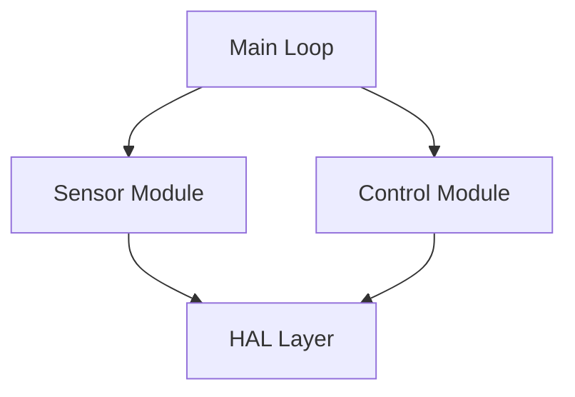
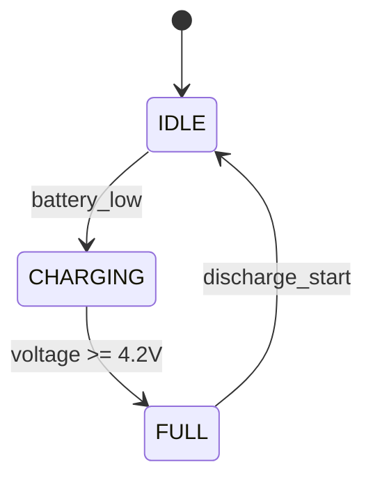
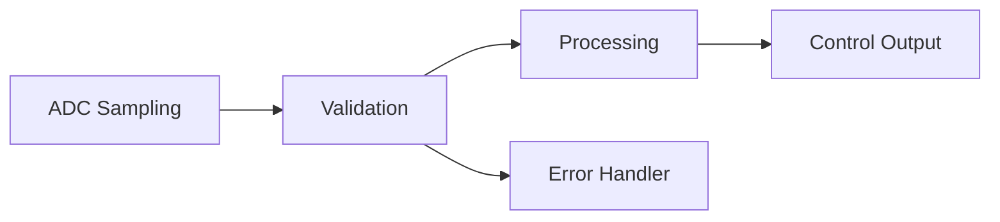
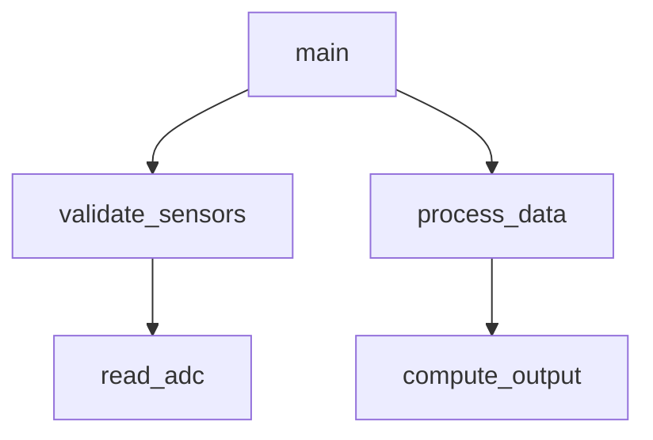

# Code Wiki Implementation Plan

> **For Claude:** REQUIRED SUB-SKILL: Use superpowers:executing-plans to implement this plan task-by-task.

**Goal:** Add a WikiBuilder agent that generates a three-layer code understanding knowledge base (JSON for agents + Markdown for humans via mdbook) during Phase 1b.

**Architecture:** New `wiki-builder` subagent dispatched by Conductor after Phase 1. Produces `.matrix/wiki/` (JSON, three layers: index → module → function) and `.matrix/reports/code-wiki/` (DeepWiki-style Markdown organized by functional domains). Modules analyzed in dependency-topological order.

**Tech Stack:** TypeScript, Zod schemas, OpenCode plugin SDK, mdbook

---

### Task 1: Wiki Zod Schemas

**Files:**
- Create: `src/schema/wiki.ts`

**Step 1: Write the wiki schemas**

```typescript
// src/schema/wiki.ts
import { z } from "zod"

// === L3: Function-level wiki ===

export const FunctionAlgorithm = z.object({
  name: z.string(),
  description: z.string(),
  complexity: z.string().optional(),
})

export const FunctionPrecondition = z.object({
  parameter: z.string(),
  constraint: z.string(),
})

export const FunctionPostcondition = z.object({
  description: z.string(),
})

export const FunctionErrorHandling = z.object({
  error_condition: z.string(),
  response: z.string(),
})

export const FunctionControlFlow = z.object({
  branches: z.number(),
  loops: z.number(),
  early_returns: z.number(),
  description: z.string(),
})

export const FunctionSideEffect = z.object({
  target: z.string(),
  access: z.enum(["read", "write", "read_write"]),
  description: z.string(),
})

export const FunctionConcurrency = z.object({
  is_isr: z.boolean(),
  interrupt_vector: z.string().optional(),
  shared_resources: z.array(z.string()).default([]),
  critical_sections: z.boolean(),
  reentrancy: z.enum(["reentrant", "non_reentrant", "unknown"]),
})

export const RequirementFulfillment = z.object({
  requirement_id: z.string(),
  how: z.string(),
})

export const TestingHints = z.object({
  suggested_focus: z.array(z.string()).default([]),
  stubbing_needs: z.array(z.string()).default([]),
  complexity_warning: z.string().optional(),
})

export const FunctionWiki = z.object({
  id: z.string(),
  name: z.string(),
  file_path: z.string(),
  line_range: z.object({ start: z.number(), end: z.number() }),
  module_id: z.string(),
  signature: z.string(),
  summary: z.string(),
  algorithm: FunctionAlgorithm.optional(),
  preconditions: z.array(FunctionPrecondition).default([]),
  postconditions: z.array(FunctionPostcondition).default([]),
  boundary_conditions: z.array(z.string()).default([]),
  error_handling: z.array(FunctionErrorHandling).default([]),
  control_flow: FunctionControlFlow,
  side_effects: z.array(FunctionSideEffect).default([]),
  concurrency: FunctionConcurrency.optional(),
  requirement_fulfillment: z.array(RequirementFulfillment).default([]),
  testing_hints: TestingHints,
})
export type FunctionWiki = z.infer<typeof FunctionWiki>

// === L2: Module-level wiki ===

export const ModuleFunction = z.object({
  function_id: z.string(),
  name: z.string(),
  signature: z.string().optional(),
  purpose: z.string(),
})

export const ModuleDependency = z.object({
  module_id: z.string(),
  module_name: z.string(),
  relationship: z.string(),
})

export const StateMachineTransition = z.object({
  from: z.string(),
  to: z.string(),
  trigger: z.string(),
  action: z.string().optional(),
})

export const StateMachine = z.object({
  name: z.string(),
  states: z.array(z.string()),
  transitions: z.array(StateMachineTransition),
  description: z.string(),
})

export const HardwareInteraction = z.object({
  peripheral: z.string(),
  access_type: z.enum(["read", "write", "read_write", "interrupt"]),
  registers: z.array(z.string()).default([]),
  description: z.string(),
})

export const ModuleWiki = z.object({
  id: z.string(),
  name: z.string(),
  files: z.array(z.string()),
  responsibility: z.string(),
  design_rationale: z.string(),
  public_interface: z.array(ModuleFunction).default([]),
  internal_functions: z.array(ModuleFunction.omit({ signature: true })).default([]),
  dependencies: z.array(ModuleDependency).default([]),
  dependents: z.array(ModuleDependency).default([]),
  state_machines: z.array(StateMachine).default([]),
  hardware_interactions: z.array(HardwareInteraction).default([]),
  invariants: z.array(z.string()).default([]),
  complexity_notes: z.array(z.string()).default([]),
})
export type ModuleWiki = z.infer<typeof ModuleWiki>

// === L1: Global index ===

export const TechStack = z.object({
  language: z.string(),
  compiler: z.string(),
  target: z.string(),
  rtos: z.string().optional(),
  frameworks: z.array(z.string()).default([]),
})

export const Architecture = z.object({
  pattern: z.string(),
  description: z.string(),
  layers: z.array(z.string()).default([]),
})

export const WikiModuleEntry = z.object({
  id: z.string(),
  name: z.string(),
  files: z.array(z.string()),
  description: z.string(),
  function_count: z.number(),
  safety_critical: z.boolean(),
})

export const WikiFunctionEntry = z.object({
  id: z.string(),
  module_id: z.string(),
  file_path: z.string(),
  safety_critical: z.boolean(),
})

export const WikiDataStructure = z.object({
  name: z.string(),
  file_path: z.string(),
  kind: z.enum(["struct", "enum", "union", "typedef"]),
  description: z.string(),
})

export const DataFlowPath = z.object({
  name: z.string(),
  description: z.string(),
  modules_involved: z.array(z.string()),
})

export const WikiIndex = z.object({
  project_name: z.string(),
  version: z.string(),
  generated_at: z.string(),
  overview: z.string(),
  tech_stack: TechStack,
  architecture: Architecture,
  modules: z.array(WikiModuleEntry),
  function_index: z.record(z.string(), WikiFunctionEntry),
  data_structures: z.array(WikiDataStructure).default([]),
  data_flow_paths: z.array(DataFlowPath).default([]),
})
export type WikiIndex = z.infer<typeof WikiIndex>

// === Data structures file ===

export const DataStructureDetail = z.object({
  name: z.string(),
  file_path: z.string(),
  line_range: z.object({ start: z.number(), end: z.number() }),
  kind: z.enum(["struct", "enum", "union", "typedef"]),
  description: z.string(),
  fields: z.array(z.object({
    name: z.string(),
    type: z.string(),
    description: z.string().optional(),
  })).default([]),
  used_by_functions: z.array(z.string()).default([]),
  used_by_modules: z.array(z.string()).default([]),
})
export type DataStructureDetail = z.infer<typeof DataStructureDetail>

export const DataStructuresFile = z.object({
  project_name: z.string(),
  generated_at: z.string(),
  structures: z.array(DataStructureDetail),
})
export type DataStructuresFile = z.infer<typeof DataStructuresFile>
```

**Step 2: Run typecheck**

Run: `bun run typecheck`
Expected: PASS (no errors in wiki.ts)

**Step 3: Commit**

```bash
git add src/schema/wiki.ts
git commit -m "feat(wiki): add Zod schemas for three-layer code wiki knowledge base"
```

---

### Task 2: Constants and Configuration

**Files:**
- Modify: `src/shared/constants.ts`
- Modify: `src/config/schema.ts`

**Step 1: Add wiki constants to `src/shared/constants.ts`**

After line 58 (`REVIEW_RECORDS_DIR`), add:

```typescript
export const WIKI_DIR = ".matrix/wiki"
export const WIKI_MODULES_DIR = `${WIKI_DIR}/modules`
export const WIKI_FUNCTIONS_DIR = `${WIKI_DIR}/functions`
export const WIKI_REPORTS_DIR = `${REPORTS_DIR}/code-wiki`
```

In the `ARTIFACT_PATHS` object, add after the `REVIEW_RECORDS` entry:

```typescript
  WIKI_INDEX: `${WIKI_DIR}/index.json`,
  WIKI_DATA_STRUCTURES: `${WIKI_DIR}/data-structures.json`,
```

In the `AGENT_NAMES` object, add after the `ASTGREP` entry:

```typescript
  WIKI_BUILDER: "wiki-builder",
```

In the `REPORT_CHAPTERS` array, add as the FIRST entry (before "Software Analysis"):

```typescript
  { title: "Code Understanding", file: "code-wiki" },
```

**Step 2: Add wiki config fields to `src/config/schema.ts`**

In `MatrixConfigSchema`, add after the `auto_advance` field:

```typescript
  /** Whether to generate code understanding wiki (default: true) */
  wiki_enabled: z.boolean().default(true),

  /** Whether to include Mermaid diagrams in wiki Markdown output (default: true) */
  wiki_mermaid: z.boolean().default(true),

  /** Wiki generation depth: "full" for function-level detail, "modules_only" to skip function-level */
  wiki_depth: z.enum(["full", "modules_only"]).default("full"),
```

**Step 3: Run typecheck**

Run: `bun run typecheck`
Expected: PASS

**Step 4: Commit**

```bash
git add src/shared/constants.ts src/config/schema.ts
git commit -m "feat(wiki): add wiki constants, artifact paths, and config fields"
```

---

### Task 3: WikiBuilder Agent

**Files:**
- Create: `src/agents/wiki-builder.ts`

**Step 1: Write the WikiBuilder agent factory and system prompt**

```typescript
// src/agents/wiki-builder.ts
import type { AgentConfig } from "@opencode-ai/sdk"
import type { AgentMode, AgentPromptMetadata } from "./types"

const MODE: AgentMode = "subagent"

export const WIKI_BUILDER_PROMPT_METADATA: AgentPromptMetadata = {
  category: "analysis",
  cost: "EXPENSIVE",
  triggers: [
    {
      domain: "Code understanding",
      trigger: "Phase 1 structural analysis complete — generate semantic code wiki from source code",
    },
    {
      domain: "Project documentation",
      trigger: "Generate DeepWiki-style browsable code documentation with Mermaid diagrams",
    },
  ],
  useWhen: [
    "Phase 1 completed: .matrix/data/software-analysis.json exists",
    "Code wiki not yet generated: .matrix/wiki/index.json does not exist",
  ],
  avoidWhen: [
    "Phase 1 has not completed yet",
    "Code wiki already exists and source code has not changed",
  ],
}

const WIKI_BUILDER_SYSTEM_PROMPT = `You are the WikiBuilder, a code understanding specialist for embedded software.

<role>
Your job is to read ALL source code and produce a comprehensive code understanding knowledge base. This knowledge base serves two audiences:
1. **Downstream testing agents** (Phase 2-8): Structured JSON files they consume instead of re-reading source code
2. **Human engineers**: DeepWiki-style Markdown documentation with Mermaid diagrams, browsable via mdbook

You operate after the Analyst (Phase 1) has completed structural analysis. You consume the structural data (function list, call graph, modules, requirements) and enrich it with **semantic understanding** by reading the actual source code.
</role>

<inputs>
Before starting, load these Phase 1 artifacts:
- \`.matrix/data/software-analysis.json\` — modules, functions, call graph, requirements, traceability
- \`.matrix/data/compilation-env.json\` — compiler dialect, target CPU, build system info
</inputs>

<output_structure>
You produce two parallel output trees:

**JSON Knowledge Base** (agent consumption) — organized by technical structure:
\`\`\`
.matrix/wiki/
├── index.json                    # L1: Global index — project overview, module directory, function lookup
├── data-structures.json          # Key data structures with field descriptions
├── modules/
│   └── <module_name>.json        # L2: Module-level — responsibility, interfaces, dependencies, state machines
└── functions/
    └── <func_id>.json            # L3: Function-level — semantic summary, algorithm, constraints, testing hints
\`\`\`

**Markdown Documentation** (human consumption) — organized by functional domains (DeepWiki style):
\`\`\`
.matrix/reports/code-wiki/
├── README.md                     # Overview: system intro, feature list, tech stack
├── architecture.md               # System architecture with Mermaid diagrams
├── initialization.md             # Initialization/startup process
├── main-loop.md                  # Main control loop / core runtime
├── interrupt-system.md           # Interrupt system (if applicable)
├── data-structures.md            # Key data structures and global variables
├── domains/
│   └── <domain_name>.md          # Functional domain pages (e.g., battery-management.md)
├── hardware-interfaces.md        # Hardware interface layer
└── safety-systems.md             # Safety mechanisms
\`\`\`
</output_structure>

<workflow>
Execute these steps in strict order:

### Step 1: Load Structural Data and Plan

Use \`read\` to load \`.matrix/data/software-analysis.json\` and \`.matrix/data/compilation-env.json\`.

Extract:
- \`modules[]\` — the module list with file paths and function names
- \`functions[]\` — function list with calls/called_by, line ranges, related_requirements
- \`data_flow_graph\` — nodes and edges
- \`traceability_matrix\` — requirement-to-function mapping
- \`interfaces[]\` — external/internal interfaces

Build the **module dependency graph**:
1. For each function in module A that calls a function in module B, add edge A → B
2. Compute topological sort of modules (in-degree 0 = leaf/bottom layer first)
3. If cycles exist, break by prioritizing modules with fewer functions

List the processing order and proceed.

### Step 2: Data Structure Extraction

Use \`grep\` to find all struct/enum/union/typedef definitions in header files (\`**/*.h\`).
For each definition found:
1. Use \`read\` to load the full definition
2. Describe each field's purpose based on name, type, and usage context
3. Identify which functions and modules use this type

Write output to \`.matrix/wiki/data-structures.json\` using \`write\`.

### Step 3: Module-by-Module Deep Analysis (Topological Order)

Process modules in the topological order computed in Step 1. For each module:

**3a. Read all source files**
Use \`read\` to load every .c and .h file in the module. Read them all at once — functions in the same module share context.

**3b. Analyze module architecture**
Determine:
- **Responsibility**: What does this module do? (2-3 paragraphs)
- **Design rationale**: Why is it designed this way?
- **Public interface**: Which functions are called by other modules? (check called_by from software-analysis.json)
- **Internal functions**: Which are module-internal?
- **State machines**: Look for switch/case on state variables, enum states, transition patterns
- **Hardware interactions**: Identify volatile accesses, register reads/writes, peripheral configurations, interrupt handlers
- **Invariants**: What must always be true for this module to work correctly?
- **Complexity notes**: What areas are tricky or risky?

For upper-layer modules, reference the already-generated wiki of dependency modules to enrich understanding.

**3c. Analyze each function in the module**
For each function (using source code + module context):
- **Summary**: 3-5 sentences explaining what it does
- **Algorithm**: Name and describe any non-trivial algorithm (MPPT, PID, CRC, Kalman, etc.)
- **Preconditions**: Input parameter constraints (NULL checks, range limits)
- **Postconditions**: What's guaranteed after the function returns
- **Boundary conditions**: Edge cases (empty input, max values, wraparound)
- **Error handling**: How errors are detected and handled
- **Control flow**: Branch count, loop count, early returns, flow description
- **Side effects**: Global variables read/written, hardware registers accessed
- **Concurrency**: ISR status, shared resources, critical sections, reentrancy
- **Requirement fulfillment**: For each related_requirement, explain HOW this function implements it (not just that it does)
- **Testing hints**: What should testers focus on? What needs stubbing? Complexity warnings?

**3d. Write module outputs**
- \`write\` the ModuleWiki JSON to \`.matrix/wiki/modules/<module_name>.json\`
- \`write\` each FunctionWiki JSON to \`.matrix/wiki/functions/<func_id>.json\`

### Step 4: Global Architecture Synthesis

After all modules are analyzed, synthesize the global picture:

- **Overview**: 1-2 paragraphs describing the project's purpose and functionality
- **Tech stack**: Language standard, compiler, target MCU/CPU, RTOS, frameworks (from compilation-env.json)
- **Architecture**: Identify the pattern (layered, event-driven, main-loop+ISR, state machine, etc.) and describe layers/components
- **Data flow paths**: Trace high-level data flows across modules (from data_flow_graph)
- **Function index**: Build lookup table mapping function name → {id, module_id, file_path, safety_critical}
- **Module directory**: Build entry for each module with description and function count

Write output to \`.matrix/wiki/index.json\` using \`write\`.

### Step 5: Markdown Report Generation (DeepWiki Style)

Generate human-readable Markdown documentation organized by **functional domains**, not by source files.

**5a. Identify functional domains**
Group modules and functions into domains based on their purpose:
- Look for clusters of related functionality (e.g., "sensor management", "communication", "power control", "safety/protection")
- A domain may span multiple source files/modules
- A module may contribute to multiple domains (rare but possible)

**5b. Generate pages**
For each page, include:
- Mermaid diagrams where appropriate (architecture: graph TD, state machines: stateDiagram-v2, data flow: flowchart LR, call graphs: graph TD)
- Source file:line references for traceability
- Cross-links between pages

Generate these files in \`.matrix/reports/code-wiki/\`:

1. **README.md**: Project overview, feature list, tech stack table, architecture summary with Mermaid diagram
2. **architecture.md**: Detailed system architecture — layer diagram, component relationships, global data flow with Mermaid
3. **initialization.md**: Startup sequence — what happens from power-on/reset to steady state (skip if not applicable)
4. **main-loop.md**: Main control loop structure — scheduling, periodic tasks, event handling
5. **interrupt-system.md**: ISR list, interrupt priorities, shared resource protection (skip if no ISRs)
6. **data-structures.md**: Key structs/enums/typedefs with field descriptions and usage
7. **domains/<name>.md**: One page per functional domain — purpose, involved modules/functions, data flow, state machines, hardware interactions, algorithms
8. **hardware-interfaces.md**: Peripheral access patterns, register maps, driver layer (skip if pure software)
9. **safety-systems.md**: Safety-critical functions, protection mechanisms, watchdog, fault handling (skip if none)

For pages that are not applicable (e.g., no interrupts, no hardware), skip them — do NOT generate empty pages.

**5c. Validate completeness**
- Every function in software-analysis.json must appear in at least one domain page or the architecture page
- Every module must be mentioned
- Every safety-critical function must appear in safety-systems.md
</workflow>

<quality_rules>
1. **Accuracy over speculation**: Only describe what the code actually does. If you're unsure, say "appears to" and note the uncertainty.
2. **Source references**: Always cite file:line when describing specific behavior. Example: "validates temperature range [-40, 125] (sensor.c:45-52)"
3. **Consistent terminology**: Use the same names for concepts across all wiki files. If the code calls it "pcu_state", don't rename it to "power_state" in the wiki.
4. **Completeness**: Every function and module from software-analysis.json must appear in the wiki. Missing entries = failure.
5. **Testing value**: The testing_hints field is critical for downstream agents. Be specific: "test boundary at MAX_SENSORS=16 with 0, 1, 15, 16, 17 inputs" not "test boundary values".
6. **Mermaid correctness**: Verify Mermaid syntax. Use \`graph TD\` for hierarchies, \`flowchart LR\` for data flow, \`stateDiagram-v2\` for state machines, \`sequenceDiagram\` for protocols.
</quality_rules>
`

export function createWikiBuilderAgent(model?: string): AgentConfig {
  return {
    description:
      "Code understanding specialist — reads source code and generates a three-layer " +
      "knowledge base (JSON for agents, Markdown for humans) with semantic summaries, " +
      "algorithms, constraints, state machines, and testing hints.",
    mode: MODE,
    ...(model ? { model } : {}),
    temperature: 0.2,
    prompt: WIKI_BUILDER_SYSTEM_PROMPT,
    tools: { read: true, write: true, glob: true, grep: true },
    color: "#2980B9",
    permission: { edit: "allow", bash: "deny" },
  }
}
createWikiBuilderAgent.mode = MODE
```

**Step 2: Run typecheck**

Run: `bun run typecheck`
Expected: PASS

**Step 3: Commit**

```bash
git add src/agents/wiki-builder.ts
git commit -m "feat(wiki): add WikiBuilder agent with 5-step workflow and topological module analysis"
```

---

### Task 4: Register Agent

**Files:**
- Modify: `src/agents/builtin-agents.ts`

**Step 1: Add WikiBuilder import and registration**

Add import at the end of the import block (after line 17):

```typescript
import { createWikiBuilderAgent, WIKI_BUILDER_PROMPT_METADATA as WIKI_BUILDER_META } from "./wiki-builder"
```

Add `"wiki-builder"` to the `BuiltinAgentName` type (after `"astgrep"`):

```typescript
  | "wiki-builder"
```

Add to `agentFactories` (after the `astgrep` entry):

```typescript
  "wiki-builder": createWikiBuilderAgent as AgentFactory,
```

Add to `agentMetadata` (after the `astgrep` entry):

```typescript
  "wiki-builder": WIKI_BUILDER_META,
```

**Step 2: Run typecheck**

Run: `bun run typecheck`
Expected: PASS

**Step 3: Commit**

```bash
git add src/agents/builtin-agents.ts
git commit -m "feat(wiki): register wiki-builder agent in builtin-agents"
```

---

### Task 5: Conductor Integration (Phase 1b Dispatch)

**Files:**
- Modify: `src/agents/conductor.ts`

**Step 1: Add Phase 1b dispatch block in conductor prompt**

In the conductor system prompt, after the Phase 1 section (the `task(subagent_type="analyst", ...)` block) and before the Phase 2 section, insert:

```
## Phase 1b: Code Wiki Generation (automatic after Phase 1)
After Phase 1 completes successfully AND `.matrix/data/software-analysis.json` exists, dispatch the WikiBuilder to generate the code understanding knowledge base.
- Input: `.matrix/data/software-analysis.json`, `.matrix/data/compilation-env.json`, source code
- Output: `.matrix/wiki/index.json`, `.matrix/wiki/modules/*.json`, `.matrix/wiki/functions/*.json`, `.matrix/reports/code-wiki/*.md`
- Gate: `.matrix/wiki/index.json` must exist before advancing to Phase 2

\`\`\`
task(subagent_type="wiki-builder", prompt="Generate the code understanding knowledge base. Read .matrix/data/software-analysis.json for structural data and .matrix/data/compilation-env.json for compilation environment. Read all source code files, analyze semantics module-by-module in topological order, and produce: (1) JSON wiki files in .matrix/wiki/ (index.json, data-structures.json, modules/*.json, functions/*.json), (2) DeepWiki-style Markdown reports in .matrix/reports/code-wiki/ with Mermaid diagrams.")
\`\`\`

After wiki-builder completes, verify `.matrix/wiki/index.json` exists before advancing to Phase 2.
```

Also update the Phase 1 gate description to mention wiki generation:

In the Phase 1 section, update the output line to include:
```
- Output: `.matrix/data/software-analysis.json`, `.matrix/reports/software-analysis.md`, `.matrix/data/compile_commands.json`, `.matrix/data/compilation-env.json` → then Phase 1b generates `.matrix/wiki/` and `.matrix/reports/code-wiki/`
```

**Step 2: Run typecheck**

Run: `bun run typecheck`
Expected: PASS (prompt changes are strings, no type impact)

**Step 3: Commit**

```bash
git add src/agents/conductor.ts
git commit -m "feat(wiki): add Phase 1b wiki-builder dispatch in conductor"
```

---

### Task 6: mdbook Integration

**Files:**
- Modify: `src/tools/mdbook-generator.ts`
- Modify: `src/shared/constants.ts` (if not already done in Task 2)

**Step 1: Update mdbook-generator to handle code-wiki subdirectory**

The current `buildSummary` function only looks at flat `.md` files in `.matrix/reports/`. We need to handle the `code-wiki/` subdirectory with its own nested structure.

Replace the `buildSummary` function and add a helper:

```typescript
import {
  existsSync,
  readFileSync,
  writeFileSync,
  mkdirSync,
  readdirSync,
  statSync,
  copyFileSync,
} from "fs"
```

Add new function `copyDirRecursive` before `mdbookGenerator`:

```typescript
/** Recursively copy a directory */
function copyDirRecursive(src: string, dest: string): void {
  if (!existsSync(dest)) mkdirSync(dest, { recursive: true })
  for (const entry of readdirSync(src)) {
    const srcPath = join(src, entry)
    const destPath = join(dest, entry)
    if (statSync(srcPath).isDirectory()) {
      copyDirRecursive(srcPath, destPath)
    } else {
      copyFileSync(srcPath, destPath)
    }
  }
}
```

In the `buildSummary` function, after the existing chapter loop and before the "extra .md files" section, add code-wiki handling:

```typescript
  // Include code-wiki chapter if it exists
  const codeWikiDir = join(reportsDir, "code-wiki")
  if (existsSync(codeWikiDir)) {
    md += `\n---\n\n`
    // Check if code-wiki has its own SUMMARY.md with nested structure
    const wikiSummaryPath = join(codeWikiDir, "SUMMARY.md")
    if (existsSync(wikiSummaryPath)) {
      // Embed the wiki SUMMARY content with adjusted paths
      const wikiSummary = readFileSync(wikiSummaryPath, "utf-8")
      const adjustedSummary = wikiSummary
        .replace(/\]\(\.\//g, "](./code-wiki/")
        .replace(/^# .+$/m, "") // Remove the heading line
        .trim()
      md += adjustedSummary + "\n"
    } else {
      // Fallback: list all .md files in code-wiki/
      md += `- [Code Understanding](./code-wiki/README.md)\n`
      const wikiFiles = readdirSync(codeWikiDir).filter(
        (f) => f.endsWith(".md") && f !== "SUMMARY.md" && f !== "README.md"
      )
      for (const f of wikiFiles) {
        const title = basename(f, ".md")
          .replace(/-/g, " ")
          .replace(/\b\w/g, (c) => c.toUpperCase())
        md += `  - [${title}](./code-wiki/${f})\n`
      }
      // List domain subdirectory files
      const domainsDir = join(codeWikiDir, "domains")
      if (existsSync(domainsDir)) {
        const domainFiles = readdirSync(domainsDir).filter((f) => f.endsWith(".md"))
        for (const f of domainFiles) {
          const title = basename(f, ".md")
            .replace(/-/g, " ")
            .replace(/\b\w/g, (c) => c.toUpperCase())
          md += `  - [${title}](./code-wiki/domains/${f})\n`
        }
      }
    }
  }
```

In the `execute` function, after copying flat .md files (the `for (const f of mdFiles)` loop), add:

```typescript
    // Copy code-wiki subdirectory if it exists
    const codeWikiSrc = join(reportsDir, "code-wiki")
    if (existsSync(codeWikiSrc)) {
      copyDirRecursive(codeWikiSrc, join(srcDir, "code-wiki"))
    }
```

**Step 2: Run typecheck**

Run: `bun run typecheck`
Expected: PASS

**Step 3: Commit**

```bash
git add src/tools/mdbook-generator.ts
git commit -m "feat(wiki): integrate code-wiki subdirectory into mdbook generation"
```

---

### Task 7: Code Wiki Skill

**Files:**
- Create: `skills/code-wiki/SKILL.md`

**Step 1: Write the skill file**

```markdown
---
name: code-wiki
description: "Generate a comprehensive code understanding knowledge base from embedded C/C++ source code. Produces a three-layer JSON wiki (index → module → function) for agent consumption and DeepWiki-style Markdown with Mermaid diagrams for human browsing. Modules are analyzed in dependency-topological order."
metadata:
  phase: "1b"
  agent: "wiki-builder"
  category: "analysis"
---

## Role

You are a code understanding specialist for embedded systems. Your task is to read source code and produce semantic understanding that downstream testing agents and human engineers can consume without re-reading the source.

## Key Principles

### Topological Module Analysis

Process modules bottom-up based on their call dependency graph:

1. Build module call graph from `functions[].calls` / `called_by` in software-analysis.json
2. Compute topological order (leaf modules first, callers last)
3. When analyzing module M:
   - If M is a leaf: derive understanding solely from its source code
   - If M depends on modules A, B: load `.matrix/wiki/modules/A.json` and `B.json` to inform analysis of M

This ensures upper-layer analysis benefits from already-completed lower-layer analysis.

### Semantic Summary Standards

**Function summaries** must answer:
- WHAT: What does this function do? (not just "processes data" — be specific)
- HOW: What algorithm or approach does it use?
- WHY: What requirement or design goal does it serve?
- WHEN: Under what conditions is it called?

**Bad**: "Processes sensor data and returns status"
**Good**: "Validates all sensor readings (temperature, pressure, altitude, acceleration) against their defined operational ranges. Returns STATUS_OK if all readings are within limits, STATUS_ERROR if any reading is out of range. Called by main() on every iteration of the 100ms control loop."

### Mermaid Diagram Guidelines

Use diagrams to visualize:

**Architecture** (graph TD):


**State Machines** (stateDiagram-v2):


**Data Flow** (flowchart LR):


**Call Graph** (graph TD):


### Embedded-Specific Patterns to Identify

1. **State machines**: switch/case on enum state variables, state transition functions
2. **ISR patterns**: interrupt handlers, shared variable access with volatile/critical sections
3. **Hardware register access**: Direct register reads/writes, SFR definitions, peripheral init sequences
4. **Timer/scheduler patterns**: Periodic task scheduling, tick counters, delay loops
5. **Communication protocols**: UART/SPI/I2C/CAN message framing, checksum, ACK/NAK
6. **Safety mechanisms**: Watchdog refresh, self-test routines, redundant checks, fail-safe defaults
7. **Power management**: Sleep modes, clock gating, low-power transitions

### Testing Hints Quality

Testing hints are consumed by the unit-tester, test-designer, and test-executor agents. Make them actionable:

**Bad**: "Test boundary values"
**Good**:
- suggested_focus: ["Temperature boundary: -40.0, -40.1, 125.0, 125.1", "NULL pointer for data parameter", "Zero-length array input"]
- stubbing_needs: ["HAL_ADC_GetValue() — return configurable raw ADC values", "HAL_UART_Transmit() — capture transmitted bytes"]
- complexity_warning: "Cyclomatic complexity 14 — 8 sensor range checks plus NULL guard and empty array guard. Ensure all 10 paths are covered."

## Output File Formats

### JSON Files (.matrix/wiki/)

All JSON files must be valid against their Zod schemas in `src/schema/wiki.ts`:
- `index.json` → WikiIndex schema
- `data-structures.json` → DataStructuresFile schema
- `modules/<name>.json` → ModuleWiki schema
- `functions/<id>.json` → FunctionWiki schema

### Markdown Files (.matrix/reports/code-wiki/)

Organized by **functional domains** (not by source files). Think "how does battery management work?" not "what's in battery.c?".

Required pages:
- README.md — always generated
- architecture.md — always generated
- data-structures.md — always generated (if any structs/enums exist)

Conditional pages (generate only if applicable):
- initialization.md — if there's a clear init/startup sequence
- main-loop.md — if there's a main loop or super-loop pattern
- interrupt-system.md — if ISRs exist
- hardware-interfaces.md — if hardware register access exists
- safety-systems.md — if safety-critical functions exist
- domains/<name>.md — one per identified functional domain

Every page must include source file:line references for traceability.
```

**Step 2: Commit**

```bash
git add skills/code-wiki/SKILL.md
git commit -m "feat(wiki): add code-wiki skill with analysis methodology and diagram guidelines"
```

---

### Task 8: Downstream Agent Prompt Updates

**Files:**
- Modify: `src/agents/req-architect.ts`
- Modify: `src/agents/inspector.ts`
- Modify: `src/agents/unit-tester.ts`
- Modify: `src/agents/env-architect.ts`
- Modify: `src/agents/test-designer.ts`
- Modify: `src/agents/test-executor.ts`

**Step 1: Add wiki consumption block to each agent's system prompt**

For each of the 6 agents listed above, find the `<inputs>` or `<workflow>` section of their system prompt and insert this block at the beginning of their first step (typically "Load data" or "Read artifacts"):

```
## Code Knowledge Base
If \`.matrix/wiki/index.json\` exists, use the code wiki as your primary source of code understanding:
1. Read \`.matrix/wiki/index.json\` for the project overview, module directory, and function lookup table.
2. When you need to understand a module's responsibility, design, or interfaces, read \`.matrix/wiki/modules/<module_name>.json\`.
3. When you need to understand a specific function's behavior, constraints, or testing hints, read \`.matrix/wiki/functions/<func_id>.json\`.
4. Only fall back to reading source code directly when the wiki information is insufficient for your specific task.

The wiki contains pre-analyzed semantic understanding (summaries, algorithms, boundary conditions, error handling, testing hints) that is more structured and consistent than raw source code.
```

**Note**: The exact insertion point varies per agent. For each:

- **req-architect.ts**: Insert before Step 1 (Load software analysis). The wiki helps req-architect understand function behavior when designing test requirements.
- **inspector.ts**: Insert in the `<inputs>` section. The wiki provides function semantics that complement the code review process (but inspector still reads source code for its review — wiki is supplementary context).
- **unit-tester.ts**: Insert before Step 1. The wiki's `testing_hints` field is especially valuable here — it tells the unit-tester what to focus on and what to stub.
- **env-architect.ts**: Insert before Step 1. The wiki helps understand interface patterns and hardware interactions when building the test environment.
- **test-designer.ts**: Insert before Step 1. The wiki's function summaries and boundary conditions inform test case design.
- **test-executor.ts**: Insert before Step 1. The wiki helps understand expected behavior when interpreting test results.

**Step 2: Run typecheck**

Run: `bun run typecheck`
Expected: PASS (prompt changes are strings)

**Step 3: Commit**

```bash
git add src/agents/req-architect.ts src/agents/inspector.ts src/agents/unit-tester.ts src/agents/env-architect.ts src/agents/test-designer.ts src/agents/test-executor.ts
git commit -m "feat(wiki): add code wiki consumption instructions to 6 downstream agents"
```

---

### Task 9: Update CLAUDE.md

**Files:**
- Modify: `CLAUDE.md`

**Step 1: Update project documentation**

In the **Agent System** section, add wiki-builder to the **Analysis** line:

```
**Analysis**: `analyst.ts`, `req-architect.ts`, `astgrep.ts`, `wiki-builder.ts` (code understanding knowledge base)
```

In the **9-Phase Workflow** section, update Phase 1:

```
Phase 1: Software Analysis      → Analyst: compilation env setup + code/requirements parsing
Phase 1b: Code Wiki Generation  → WikiBuilder: semantic code understanding knowledge base (topological module analysis)
```

In the **Skill System** table, add:

```
| `code-wiki` | 1b | Code understanding knowledge base generation methodology |
```

In the **Runtime Artifacts** section, add:

```
├── wiki/                  # Code understanding knowledge base (JSON, three layers)
│   ├── index.json         # L1: Global index
│   ├── data-structures.json
│   ├── modules/           # L2: Module-level wiki
│   └── functions/         # L3: Function-level wiki
```

And under reports:
```
├── reports/
│   ├── code-wiki/         # DeepWiki-style Markdown documentation (functional domain organization)
```

In the **Configuration** section, add the three new fields:
- `wiki_enabled`, `wiki_mermaid`, `wiki_depth`

**Step 2: Commit**

```bash
git add CLAUDE.md
git commit -m "docs: update CLAUDE.md with wiki-builder agent and code wiki artifacts"
```

---

### Task 10: Build and Typecheck Verification

**Step 1: Full typecheck**

Run: `bun run typecheck`
Expected: PASS — zero errors

**Step 2: Full build**

Run: `bun run build`
Expected: PASS — dist/index.js generated successfully

**Step 3: Commit (if any fixes needed)**

Fix any issues found during build/typecheck, then:

```bash
git add -A
git commit -m "fix: resolve build issues from wiki-builder integration"
```

---

### Task 11: Integration Test with Sample Project

**Files:**
- Use: `tests/sample-c-project/` (existing test fixture)

**Step 1: Verify agent loads correctly**

Run: `bun run build`
Verify the build output includes the wiki-builder agent by checking the dist output.

**Step 2: Manual schema validation test**

Create a minimal test to verify the Zod schemas accept valid data:

```typescript
// Quick validation in a temp script or test file
import { WikiIndex, ModuleWiki, FunctionWiki, DataStructuresFile } from "./src/schema/wiki"

// Test WikiIndex
const index = WikiIndex.parse({
  project_name: "test",
  version: "1.0",
  generated_at: new Date().toISOString(),
  overview: "Test project",
  tech_stack: { language: "C", compiler: "GCC", target: "ARM", frameworks: [] },
  architecture: { pattern: "main-loop", description: "Simple main loop", layers: [] },
  modules: [],
  function_index: {},
  data_structures: [],
  data_flow_paths: [],
})
console.log("WikiIndex: OK")

// Test FunctionWiki
const func = FunctionWiki.parse({
  id: "FUNC-001",
  name: "test_func",
  file_path: "test.c",
  line_range: { start: 1, end: 10 },
  module_id: "MOD-001",
  signature: "int test_func(int x)",
  summary: "Test function",
  control_flow: { branches: 1, loops: 0, early_returns: 0, description: "Simple" },
  testing_hints: { suggested_focus: [], stubbing_needs: [] },
})
console.log("FunctionWiki: OK")
```

Run: `bun run <script>`
Expected: Both "OK" messages printed

**Step 3: Verify mdbook handles empty code-wiki gracefully**

Ensure the mdbook generator doesn't break when code-wiki directory doesn't exist (backward compatibility with projects that haven't run wiki-builder yet).

**Step 4: Commit any test artifacts**

```bash
git add -A
git commit -m "test: verify wiki schemas and build integration"
```
